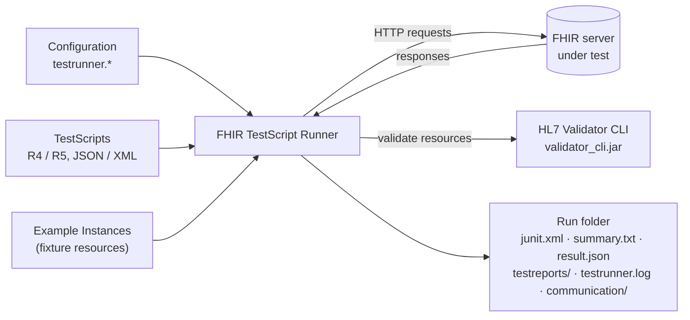

# FHIR TestScript Runner – Wiki

The runner reads FHIR `TestScript` resources and sends their requests to a FHIR server. It checks the responses
and writes the results as JUnit XML, a text summary, JSON and FHIR `TestReport`s. Every HTTP exchange is logged.

This wiki is a guided tour through the code. It explains the Maven modules, how they work together and why the
design looks the way it does.

## Where to start

| You want to … | Read |
|---|---|
| understand the whole thing in ten minutes | [The big picture](big-picture.md) |
| know what a Maven module does | [Modules](modules/README.md) |
| follow a run from start to end | [How a run works](run-lifecycle.md) |
| know how `${variable}` placeholders are resolved | [Variables and placeholders](variables.md) |
| know where fixtures come from and when they are created | [Fixtures](fixtures.md) |
| understand why it is built this way | [Design insights](design-insights.md) |
| add a feature or replace a part | [Extending the runner](extending.md) |
| build, test and run it locally | [Build and test](build-and-test.md) |
| look up a term | [Glossary](glossary.md) |
| find out why a run looks wrong | [Troubleshooting](troubleshooting.md) |
| know what to build next, and in which order | [Next steps](next-steps.md) |

## The reference documents

The wiki does not repeat the reference documents. It links to them.

| Document | Content |
|---|---|
| [README](../../README.md) | quick start, project layout |
| [architecture.md](../architecture.md) | goals, execution semantics, differences to the Python PoC, open points |
| [configuration.md](../configuration.md) | every `testrunner.*` property, library use, Spring extension |
| [fhir-versions.md](../fhir-versions.md) | R4/R5 mapping in depth, the R6 recipe |
| [logging.md](../logging.md) | run log, request ids, communication log, FHIR TestReports |
| [validation.md](../validation.md) | validator setup, process and server mode, the negative control |
| [ADRs](../adr/README.md) | the architecture decisions, with the alternatives considered |
| [config/](../../config) | development configurations |

The reference documents are the source of truth. When a behaviour changes, update them and the ADR first, then the
wiki.
