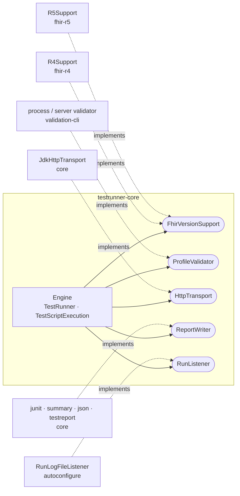
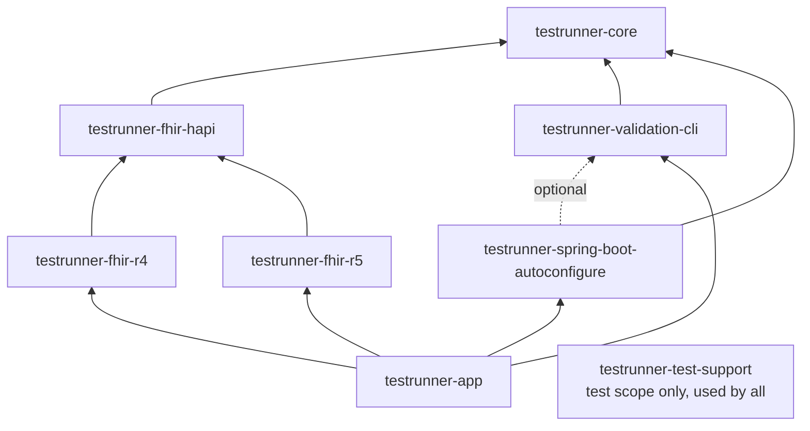

# The big picture

[Home](README.md) › The big picture

## What the runner does

1. **Read.** Find the TestScript files of each suite. Detect their FHIR version. Map them to one version-neutral
   model.
2. **Execute.** Run setup, tests and teardown against a FHIR server. Send requests, keep the responses, evaluate
   the assertions. Validate resources against profiles with the HL7 validator.
3. **Report.** Write reports, a run log and every HTTP exchange into one folder per run.

## Ports and adapters

The code follows the *hexagonal* style ([ADR-0001](../adr/0001-hexagonal-modules.md)).
The core holds the logic. Whatever may vary sits behind an interface, a *port*. Adapters implement the ports in
their own modules.

| Port | Question it answers | Implementations |
|---|---|---|
| `FhirVersionSupport` | How do I read a TestScript of FHIR version X, evaluate FHIRPath on it and write its TestReport? | `R4Support`, `R5Support` (found with `ServiceLoader`) |
| `ProfileValidator` | Is this resource valid against that profile? | process mode, server mode, `ProfileValidator.DISABLED` |
| `HttpTransport` | How do I send one HTTP request? | `JdkHttpTransport` |
| `ReportWriter` | How do I write the result in format X? | `junit`, `summary`, `json`, `testreport` |
| `RunListener` | Who wants to know when a run or TestScript starts and ends? | `RunLogFileListener` (the run log file) |

## Modules

Every arrow is a Maven dependency. All arrows point towards the core.

Details for each module: [Modules](modules/README.md).

## Three ideas that shape the code

**One version-neutral model.** R4 and R5 TestScripts are mapped to the same records (`core.model`). The engine never
sees a HAPI class or a FHIR version. A new FHIR version is a new small module, the engine stays untouched.
See [ADR-0005](../adr/0005-fhir-version-mapping.md).

**Explicit state, no globals.** The whole input is one immutable `RunConfiguration`. State has a clear owner:
`RunContext` for a run, `ExecutionState` for one TestScript execution. Results are immutable records. This is what
makes parallel execution safe. See [ADR-0003](../adr/0003-configuration.md) and
[ADR-0004](../adr/0004-no-global-state.md).

**Never a silent pass.** A green run must prove that everything was checked. A validator that could not run is an
`error`, not a `pass`. Disabled validation shows up as a warning. Content a FHIR version ignores is reported.
See [validation.md](../validation.md#a-green-run-must-prove-that-validation-ran).

## Rules the build enforces

| Rule | Enforced by |
|---|---|
| The core uses no Spring, no HAPI, no Logback, no adapter | `ArchitectureTest` (ArchUnit) |
| `fhir-r4` and `fhir-r5` do not know each other | `ArchitectureTest` |
| `fhir-hapi` uses no version-specific HAPI packages | `ArchitectureTest` |
| Adapters (`fhir..`, `validation..`) use no Spring | `ArchitectureTest` |
| The core packages have no cycles | `ArchitectureTest` |
| Only Java SE APIs (no `com.sun.*`, `sun.*`, `jdk.*`) | compiler flag `--limit-modules java.se` |
| Java ≥ 25, Maven ≥ 3.9, test doubles only in test scope | `maven-enforcer-plugin` |
| No compiler warnings | `-Xlint:all` (by convention) |

## Two ways to use it

* **Command line.** `java -jar testrunner-app-…-exec.jar --config=my-run.yml`. Spring Boot binds the configuration
  and wires everything. See [testrunner-app](modules/testrunner-app.md).
* **Library.** Build a `RunConfiguration` in code and call `TestRunner.run(configuration)`. No Spring needed.
  See [configuration.md](../configuration.md#using-it-as-a-library).

Next: [How a run works](run-lifecycle.md).
