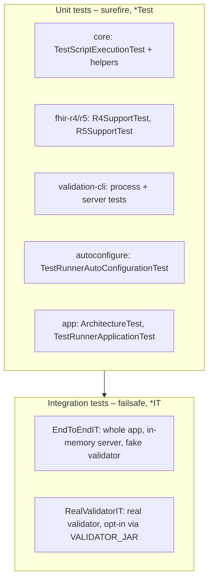

# Build and test

[Home](README.md) › Build and test

## Requirements

* Java 25 and Maven 3.9+. The enforcer stops the build otherwise.
* For profile validation: the HL7 Validator CLI, `validator_cli.jar`
  ([download](https://github.com/hapifhir/org.hl7.fhir.core/releases/latest/download/validator_cli.jar)).
* For real runs: a FHIR server, e.g. `docker run -p 8080:8080 -e hapi.fhir.fhir_version=R4 hapiproject/hapi:latest`.

The tests need neither a FHIR server nor the validator.

## Commands

| Goal | Command |
|---|---|
| Build and run all tests | `mvn -B verify` |
| Jar without tests | `mvn -B -DskipTests package` |
| One module and its dependencies | `mvn -B -pl testrunner-validation-cli -am test` |
| One test class | `mvn -B -pl testrunner-core -am test -Dtest=TestScriptExecutionTest -Dsurefire.failIfNoSpecifiedTests=false` |
| Also with the real validator | `VALIDATOR_JAR=/path/to/validator_cli.jar mvn -B verify` |

More variants: skill `.claude/skills/testrunner-build-and-run`.

## Run it

```sh
export VALIDATOR_JAR=/path/to/validator_cli.jar
java -jar testrunner-app/target/testrunner-app-0.1.0-SNAPSHOT-exec.jar --config=config/dev-r4.yml
```

| Config | Runs |
|---|---|
| [`dev-r4.yml`](../../config/dev-r4.yml) | AT Core R4 create and update |
| [`dev-r5.yml`](../../config/dev-r5.yml) | AT Core R5 |
| [`dev-all.yml`](../../config/dev-all.yml) | all samples, parallel, R4 server on 8080 and R5 server on 8081 |
| [`negative-control.yml`](../../config/negative-control.yml) | the negative control – **must fail** |

Results land in `target/testrunner-results/run_<timestamp>/`.

## Test levels



| Test | Uses |
|---|---|
| engine tests | `InMemoryFhirServer`, models built in code (`Harness`, `Scripts`) |
| version module tests | the TestScripts in `testdata/` |
| validator tests | `FakeValidatorJar` |
| `EndToEndIT` | all of the above, through Spring Boot |

`RealValidatorIT` is skipped without `VALIDATOR_JAR`. A skip in the summary is expected.

## Continuous integration

[`.github/workflows/build.yml`](../../.github/workflows/build.yml) runs on GitHub Actions:

| Job | When | What |
|---|---|---|
| `verify` | every push to `main`, every pull request | `mvn -B verify` on Temurin 25. If it fails, the surefire and failsafe reports are attached to the run as `test-reports`. |
| `real-validator` | nightly (03:17 UTC) and on demand (*Run workflow*) | `RealValidatorIT` with the real validator, both modes. The negative control must fail. |

The real validator is pinned (`VALIDATOR_VERSION`, now 7.0.2, the version the docs were verified with). The job
caches it and the FHIR packages, so only the first run downloads them. Raise the version deliberately, after
checking the negative control locally:

```sh
curl -L -o /tmp/validator_cli.jar \
  https://github.com/hapifhir/org.hl7.fhir.core/releases/download/7.0.4/validator_cli.jar
VALIDATOR_JAR=/tmp/validator_cli.jar mvn -B verify -pl testrunner-app -am \
  -Dtest=NoSuchTest -Dsurefire.failIfNoSpecifiedTests=false \
  -Dit.test=RealValidatorIT -Dfailsafe.failIfNoSpecifiedTests=false
```

A failed nightly run is a signal about the validator or the packages, not about a commit.

## Test data

`testdata/` holds the TestScripts, Example Instances and profiles from the Python PoC:

```
testdata/
├─ r4/        AT Core R4: create, update, negative control
├─ r5/        AT Core R5: create, update
└─ samples/   mixed R4/R5, JSON/XML: one TestScript per feature
   ├─ Test_Scripts/
   ├─ Example_Instances/   resources behind fixture.resource.reference
   └─ Profiles/            passed to the validator as -ig
```

## Conventions

* JUnit 5 + AssertJ. `@TempDir` for files.
* Test names describe behaviour: `crashedServerFallsBackToOneProcessPerValidationAndIsNotRestarted`.
* No JDK-internal APIs, also not in tests. HTTP servers in tests use Jetty.
* A new double goes into `testrunner-test-support/src/test/java`.

More: skill `.claude/skills/testrunner-testing`, [ADR-0009](../adr/0009-testing.md).

## The POM in short

| Rule | Where |
|---|---|
| Third-party versions from the Spring Boot BOM and the HAPI FHIR BOM | root `pom.xml`, properties `spring-boot.version`, `hapi-fhir.version` |
| Plugin versions as properties | root `pom.xml` |
| Module POMs declare **no** versions | every module |
| `-Xlint:all,-processing,-serial`, `--limit-modules java.se` | compiler plugin in the root `pom.xml` |
| A compiler warning fails the build (`failOnWarning`) | compiler plugin in the root `pom.xml` |
| Test doubles only in test scope | enforcer `bannedDependencies` |

→ [ADR-0010](../adr/0010-build.md)
