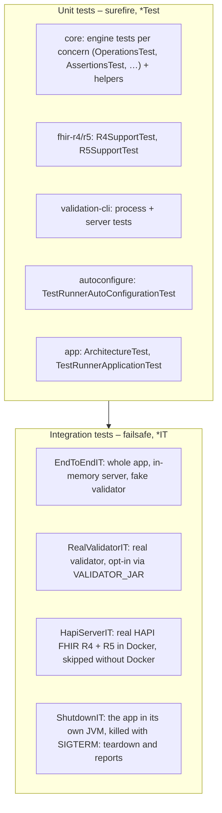

# Build and test

[Home](README.md) › Build and test

## Requirements

* Java 25 and Maven 3.9+. The enforcer stops the build otherwise.
* For profile validation: the HL7 Validator CLI, `validator_cli.jar`
  ([download](https://github.com/hapifhir/org.hl7.fhir.core/releases/latest/download/validator_cli.jar)).
* For real runs: a FHIR server, e.g. `docker run -p 8080:8080 -e hapi.fhir.fhir_version=R4 hapiproject/hapi:latest`.

The tests need neither a FHIR server nor the validator. With Docker running, `HapiServerIT` also tests against a
real HAPI FHIR server; without Docker it is skipped.

## Commands

| Goal | Command |
|---|---|
| Build and run all tests | `mvn -B verify` |
| Jar without tests | `mvn -B -DskipTests package` |
| One module and its dependencies | `mvn -B -pl testrunner-validation-cli -am test` |
| One test class | `mvn -B -pl testrunner-core -am test -Dtest=OperationsTest -Dsurefire.failIfNoSpecifiedTests=false` |
| Also with the real validator | `VALIDATOR_JAR=/path/to/validator_cli.jar mvn -B verify` |
| Only the tests against a real HAPI server (Docker) | `mvn -B verify -pl testrunner-app -am -Dtest=NoSuchTest -Dsurefire.failIfNoSpecifiedTests=false -Dit.test=HapiServerIT -Dfailsafe.failIfNoSpecifiedTests=false` |

More variants: skill `.claude/skills/testrunner-build-and-run`.

## Run it

```sh
export VALIDATOR_JAR=/path/to/validator_cli.jar
java -jar testrunner-app/target/testrunner-app-0.1.0-SNAPSHOT-exec.jar --config=config/dev-r4.yml
```

| Config | Runs |
|---|---|
| [`dev-r4.yml`](../../config/dev-r4.yml) | AT Core R4 create and update |
| [`dev-r5.yml`](../../config/dev-r5.yml) | AT Core R5 |
| [`dev-all.yml`](../../config/dev-all.yml) | all samples, parallel, R4 server on 8080 and R5 server on 8081 |
| [`negative-control.yml`](../../config/negative-control.yml) | the negative control – **must fail** |

Results land in `target/testrunner-results/run_<timestamp>/`.

## Container image

`testrunner-app/Dockerfile` puts the executable jar on a Java 25 LTS JRE (`eclipse-temurin:25.0.5_8-jre-noble`;
Dependabot ignores major versions of the base image). One Dockerfile, two images
([ADR-0015](../adr/0015-container-image.md), [ADR-0020](../adr/0020-published-images.md)):

| Target | Holds | Published as |
|---|---|---|
| `slim` (the default) | the runner only; what changes per project is mounted | `ghcr.io/mratzenb/fhir-testrunner:X.Y.Z` |
| `validator` | the same plus the HL7 validator at `/opt/validator/validator_cli.jar`, `VALIDATOR_JAR` set | `…:X.Y.Z-validator` |

```sh
mvn -B -DskipTests package                         # the images are built from the exec jar
docker build -t testrunner testrunner-app          # slim
docker build -t testrunner:validator --target validator testrunner-app
docker run --rm --user "$(id -u):$(id -g)" -v "$PWD:/workspace" testrunner --config=config/dev-r4.yml --check --novalidator
ci/smoke-test-image.sh testrunner slim             # what CI does with a built image; the validator image also runs
ci/smoke-test-image.sh testrunner:validator validator   # AT Core and the negative control against HAPI (needs the internet)
```

Using the published images in the pipelines of other projects: [CI integration](ci-integration.md).

The licenses are in `/licenses` ([Licenses in the artifacts](#licenses-in-the-artifacts)).

The entry point is the launcher `testrunner` (`testrunner-app/docker/testrunner`, on the `PATH`): it starts the runner
through the base image's certificate entry point. A pipeline that replaces the entry point (GitLab CI) calls it by name.

| Mount | Container path | Why |
|---|---|---|
| the project folder | `/workspace` (the working directory) | configuration, suites and results; relative paths in a configuration start here |
| `validator_cli.jar` | anywhere, e.g. `/opt/validator/validator_cli.jar`, named by `VALIDATOR_JAR` or `testrunner.validation.validator-jar` | profile validation with the slim image, whose validator version is yours; the validator image has its own |
| `~/.fhir/packages` | `/home/runner/.fhir/packages` | the FHIR package cache of the validator and of `package-id` suites; without it every container downloads the packages again |

* The container runs as user `runner` (10001). With `--user "$(id -u):$(id -g)"` the results belong to you.
* A FHIR server on the host is `http://host.docker.internal:8080/fhir` from inside the container (Docker Desktop,
  Rancher Desktop; on Linux add `--add-host=host.docker.internal:host-gateway`).
* A server whose certificate a company CA signed: mount the CA certificates at `/certificates` and set
  `USE_SYSTEM_CA_CERTS=1`. The base image adds them to Java's trust store at start.

### With HAPI FHIR: docker compose

[`docker-compose.yml`](../../docker-compose.yml) starts HAPI FHIR `v8.12.0-1` (R4, the lenient settings of
`HapiServerIT`) and runs the runner against it, with the project folder, `validator_cli.jar` and the package cache
mounted:

```sh
mvn -B -DskipTests package
docker compose run --rm testrunner                                   # config/dev-r4.yml, with validation
docker compose run --rm testrunner --config=config/dev-r4.yml --novalidator --testscript='*update*'
docker compose down                                                  # HAPI keeps its data in memory only
```

The runner waits until HAPI answers `/fhir/metadata` (~15 s on first start). `docker compose build` rebuilds the image
after a new `mvn package`. The validator jar is taken from the project folder, or from `VALIDATOR_JAR` on the host.

## Test levels



| Test | Uses |
|---|---|
| engine tests | `InMemoryFhirServer`, models built in code (`Harness`, `Scripts`) |
| version module tests | the TestScripts in `testdata/` |
| validator tests | `FakeValidatorJar` |
| `EndToEndIT` | all of the above, through Spring Boot |
| `HapiServerIT` | Testcontainers: `hapiproject/hapi:v8.12.0-1`, R4 and R5, the sample suites |

`RealValidatorIT` is skipped without `VALIDATOR_JAR`, `HapiServerIT` without Docker. A skip in the summary is
expected.

### Against a real FHIR server

`HapiServerIT` starts three HAPI FHIR servers once per test class (R4, R5 and a second R4, ~40 s) and runs the AT
Core suites (R4 and R5), the samples and the TestScript for two servers (`testdata/several-servers`) against them. The samples assume a lenient server, so the containers run with these settings, the same
as the PoC's `docker-compose.yml`:

| HAPI setting | Value | Why |
|---|---|---|
| `hapi.fhir.enforce_referential_integrity_on_write` | `false` | fixtures reference resources that are not on the server, e.g. `managingOrganization` |
| `hapi.fhir.enforce_referential_integrity_on_delete` | `false` | autodelete removes fixtures that other fixtures still reference |
| `hapi.fhir.allow_multiple_delete` | `true` | the samples delete by search, which can match several resources |

With HAPI's defaults the same samples get `409 Conflict` on those deletes. That is the server's right, not a runner
problem. A suite meant for strict servers should delete in reverse order of its references.

### Docker on macOS

Testcontainers looks for Docker at `/var/run/docker.sock`. Rancher Desktop and Colima put their socket elsewhere, so
Testcontainers finds nothing and **`HapiServerIT` is skipped – the build stays green**. Only two things show it:

```
[WARNING] Tests run: 4, Failures: 0, Errors: 0, Skipped: 4 -- in at.hl7.testing.runner.app.HapiServerIT
ERROR DockerClientProviderStrategy - Could not find a valid Docker environment. …
```

Point Testcontainers at the socket before running Maven:

```sh
export DOCKER_HOST=unix://$HOME/.rd/docker.sock                  # Rancher Desktop
# export DOCKER_HOST=unix://$HOME/.colima/default/docker.sock    # Colima
export TESTCONTAINERS_DOCKER_SOCKET_OVERRIDE=/var/run/docker.sock
```

* `DOCKER_HOST` is where the runner's JVM reaches Docker on the Mac.
* `TESTCONTAINERS_DOCKER_SOCKET_OVERRIDE` is where the socket is *inside* the Linux VM. Testcontainers mounts it into
  its helper container (Ryuk, which removes the containers after the tests); the Mac path does not exist there.
* Put both lines into `~/.zshrc` to set them once. In IntelliJ, add them to the environment of the run configuration;
  it does not read `~/.zshrc`.

With both set, the log may still show `WARN RyukResourceReaper - Can not connect to Ryuk at localhost:…` several
times while Ryuk starts – seven times within two seconds in one run, each with a stack trace. The tests run anyway,
and Ryuk removes the containers afterwards. What counts is the result line: `Tests run: 4, … Skipped: 0`.

Tested with Rancher Desktop. The Colima path is that tool's documented default, not tested here. CI needs neither
variable: the Linux runners have `/var/run/docker.sock`.

## Coverage

Every `mvn verify` writes one coverage report for all modules, from the unit and the integration tests:
`testrunner-app/target/site/jacoco-aggregate/index.html`. It is a report, not a gate: no build fails on a number.

As of 2026-11-05, with `HapiServerIT`:

| Module | Lines | Branches |
|---|---|---|
| `testrunner-core` | 89.6 % | 78.2 % |
| `testrunner-fhir-hapi` | 86.0 % | 67.2 % |
| `testrunner-validation-cli` | 83.0 % | 71.4 % |
| `testrunner-spring-boot-autoconfigure` | 95.1 % | 55.6 % |
| all modules | 88.8 % | 77.4 % |

Look at the report when you change the engine: an uncovered branch in `TestScriptChecks`, `ActionRules` or
`AssertionEvaluator` usually means a rule without a test. A new module must also be a dependency of `testrunner-app`,
otherwise the report leaves it out.

## Continuous integration

[`.github/workflows/build.yml`](../../.github/workflows/build.yml) runs on GitHub Actions:

| Job | When | What |
|---|---|---|
| `verify` | every push to `main`, every pull request | `mvn -B verify` on Temurin 25, including `HapiServerIT` (the runner has Docker). Then it builds the container image and checks the AT Core R4 suite with it (`--check`); the image is not published. The coverage report is attached as `coverage`, the SBOM as `sbom`. If the build fails, the surefire and failsafe reports are attached as `test-reports`. |
| `real-validator` | every push to `main`, every pull request, nightly (03:17 UTC) and on demand (*Run workflow*) | `RealValidatorIT` with the real validator, both modes. The negative control must fail. |

[`.github/workflows/image.yml`](../../.github/workflows/image.yml) builds the two container images
([above](#container-image)):

| Job | When | What |
|---|---|---|
| `jar` | every push to `main`, every pull request, every tag `vX.Y.Z` | `mvn verify` (a pull request: only `package`, `build.yml` tests it), and a check that `VALIDATOR_VERSION` of the Dockerfile and of `build.yml` agree. Hands the exec jar and the license files (`target/classes/META-INF`) to the next job. |
| `image` (slim, validator) | the same | builds the image for amd64, runs `ci/smoke-test-image.sh` and the GitHub Action ([`action.yml`](../../action.yml)) against it (the validator image against HAPI FHIR from `docker-compose.yml`; the negative control must fail). Pull requests stop here, and so does every other run as long as the repository variable `PUBLISH_IMAGES` is not `true` (*Settings › Secrets and variables › Actions › Variables*). With it set, a push to `main` or a tag then builds amd64 and arm64 again from the cache and pushes to GHCR: `edge`, or `X.Y.Z`, `X.Y`, `latest`, each also with `-validator`. |

`verify` and `real-validator` run in parallel and together run every test, so a feature branch is tested against
everything before it is merged into `main`. To enforce that, make both jobs required status checks in the branch
protection (or ruleset) of `main`: *Settings › Branches*.

The real validator is pinned (`VALIDATOR_VERSION`, now 7.0.2, the version the docs were verified with). The job
caches it and the FHIR packages, so only the first run downloads them. The cache is saved only after a successful
job, so a failed run starts cold again. A pull request restores the cache that `main` saved; the first run on a
repository without one downloads the validator and the packages from the internet.

`RealValidatorIT` starts three validator processes at once, and on an empty `~/.fhir/packages` they would install the
same packages together, which the validator's cache locking does not survive (`NoSuchFileException: …lock ->
…lock-deletion`, exit code 1, the TestScript ends as `error`). The runner prevents that itself: the first validation of
each configuration runs alone ([validation.md](../validation.md#validator-processes-and-the-package-cache)). The job
still fills the cache in a step of its own before the IT ("Fill the FHIR package cache"), so that a network or registry
problem fails there with the validator's own output instead of as errors inside the IT.

To try the cold start locally without touching your own cache, give the validator JVMs another home:
`TESTRUNNER_VALIDATION_JVMARGUMENTS=-Duser.home=/tmp/fhir-home VALIDATOR_JAR=… mvn …` (the command below).

### Raising the validator version

The version is in two places, which must agree (`image.yml` fails otherwise): `VALIDATOR_VERSION` in `build.yml`
and `ARG VALIDATOR_VERSION` and `ARG VALIDATOR_SHA256` in `testrunner-app/Dockerfile`, which the validator image checks the
download against (`sha256sum validator_cli.jar`; GitHub shows the digest of a release asset too). A new validator is a new
runner release. Raise it deliberately, after checking the negative control locally:

```sh
curl -L -o /tmp/validator_cli.jar \
  https://github.com/hapifhir/org.hl7.fhir.core/releases/download/7.0.4/validator_cli.jar
VALIDATOR_JAR=/tmp/validator_cli.jar mvn -B verify -pl testrunner-app -am \
  -Dtest=NoSuchTest -Dsurefire.failIfNoSpecifiedTests=false \
  -Dit.test=RealValidatorIT -Dfailsafe.failIfNoSpecifiedTests=false
```

After the check, build the image and run `ci/smoke-test-image.sh testrunner:validator validator` (see
[Container image](#container-image)).

A failed nightly run is a signal about the validator or the packages, not about a commit. A failed `real-validator`
job on a pull request is a signal about the commit, unless the log shows a download or registry problem: then run
the job again.

### Dependency updates and the SBOM

[Dependabot](../../.github/dependabot.yml) opens pull requests every Monday for new versions of the Maven
dependencies, the Maven plugins and the GitHub Actions. Spring Boot, HAPI FHIR and the Maven plugins each come as one
grouped pull request. Major versions of Spring Boot and HAPI FHIR are left out: they are decisions of their own. The
`verify` job tests each pull request like any other. A HAPI FHIR update should also raise the image tag in
`HapiServerIT` and in `docker-compose.yml` to the matching `hapiproject/hapi` release (the smoke test of the images
reads it from there). Dependabot also watches the base image of the Dockerfile, and the GitHub Actions the workflows
use; the images stay on Java 25 LTS, a newer Java is a decision of its own.

`mvn package` writes the software bill of materials of the executable jar to `testrunner-app/target/bom.json` and
`bom.xml` (CycloneDX 1.6): every library the jar ships, with version, hashes and license, test libraries excluded.
Feed it to a scanner such as Dependency-Track or `grype sbom:testrunner-app/target/bom.json`. In offline mode
(`mvn -o`) the plugin skips the SBOM.

### Licenses in the artifacts

The runner is MPL 2.0 and delivers libraries under other licenses, so the license files travel with the artifacts
(MPL 2.0 asks to say how to get the source of Saxon-HE, EPL 2.0 and Apache 2.0 ask for their texts):

| Where | What |
|---|---|
| `META-INF/LICENSE` of **every** jar | the license of the runner (the root `LICENSE`, a resource of the root POM) |
| `META-INF/THIRD-PARTY-NOTICES.txt` of the executable jar | every library it ships: name, license, project page, and the Maven Central folder with its sources jar. Written at `generate-resources` by `license-maven-plugin:add-third-party` with the template [`testrunner-app/src/license/third-party-notices.ftl`](../../testrunner-app/src/license/third-party-notices.ftl); `licenseMerges` give the licenses one name each. A library without license information fails the build (`failOnMissing`) |
| `META-INF/licenses/` of the executable jar | the texts of Apache-2.0, EPL-2.0 and Unicode-3.0 (`testrunner-app/src/license/licenses/`) |
| `/licenses/` of both container images | the same three: `LICENSE`, `THIRD-PARTY-NOTICES.txt`, `licenses/`; the validator image also `HL7-VALIDATOR.txt` (what the jar is, its source) and `/opt/validator/LICENSE.txt` |

A new library needs nothing, unless its POM names its license differently from the others: the notice file then lists
that name as it is (add a `licenseMerge` in `testrunner-app/pom.xml`). If it has no license information, or one that
the MPL project should not ship (a copyleft license beyond the file level), decide before you merge. The smoke test of
the images and `image.yml` check that the files are in the images and in the jar.

## Test data

The wiki's own samples, [`samples/`](samples), are tested too: `EndToEndIT.wikiSampleSuitePasses` and
`wikiMistakesAreReportedBeforeAnythingIsSent` run them on each build (`SampleData.wikiSamples()`). Change a sample
and the page [Samples](samples.md) together.

`testdata/` holds the TestScripts, Example Instances and profiles from the Python PoC:

```
testdata/
├─ r4/        AT Core R4: create, update, negative control
├─ r5/        AT Core R5: create, update
├─ samples/   mixed R4/R5, JSON/XML: one TestScript per feature
└─ several-servers/   a TestScript for two servers (destination 1 and 2), see ADR-0019
   ├─ Test_Scripts/
   ├─ Example_Instances/   resources behind fixture.resource.reference
   └─ Profiles/            passed to the validator as -ig
```

## Conventions

* JUnit 5 + AssertJ. `@TempDir` for files.
* Test names describe behaviour: `crashedServerFallsBackToOneProcessPerValidationAndIsNotRestarted`.
* No JDK-internal APIs, also not in tests. HTTP servers in tests use Jetty.
* A new double goes into `testrunner-test-support/src/test/java`.

More: skill `.claude/skills/testrunner-testing`, [ADR-0009](../adr/0009-testing.md).

## The POM in short

| Rule | Where |
|---|---|
| Third-party versions from the Spring Boot BOM and the HAPI FHIR BOM | root `pom.xml`, properties `spring-boot.version`, `hapi-fhir.version` |
| Plugin versions as properties | root `pom.xml` |
| Module POMs declare **no** versions | every module |
| `-Xlint:all,-processing,-serial`, `--limit-modules java.se` | compiler plugin in the root `pom.xml` |
| A compiler warning fails the build (`failOnWarning`) | compiler plugin in the root `pom.xml` |
| Coverage of unit and integration tests, as a report | JaCoCo `prepare-agent` in the root `pom.xml`, `report-aggregate` in `testrunner-app` |
| SBOM of the executable jar | CycloneDX `makeBom` in `testrunner-app` |
| License of the runner in every jar, notices of the libraries in the executable jar and the images | `<resources>` of the root POM, `license-maven-plugin` in `testrunner-app` |
| Test doubles only in test scope | enforcer `bannedDependencies` |

→ [ADR-0010](../adr/0010-build.md)
