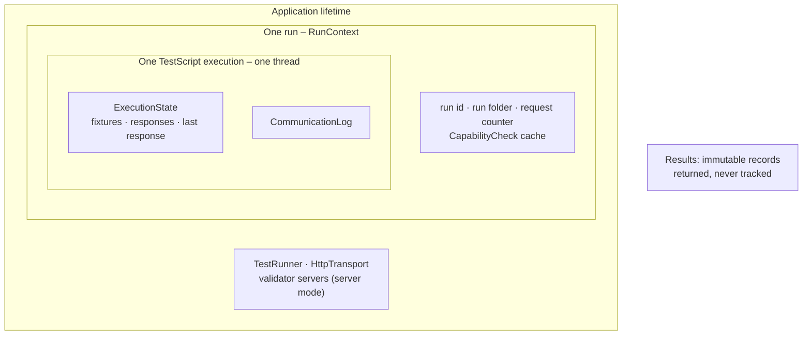

# Design insights

[Home](README.md) › Design insights

Why the code looks the way it does. Each section names the problem, the choice and its price. The formal record is
in the [ADRs](../adr/README.md).

The runner replaces a Python proof of concept (PoC). Many choices answer a concrete pain point of that PoC.

## 1. Hexagonal core, many small modules

**Problem.** The PoC's evaluator was one 1,300-line file. Parsing, HTTP, assertions, validation and results were
mixed and connected through globals.

**Choice.** A framework-free core with ports. Each adapter is its own Maven module.
ArchUnit and the compiler keep the boundaries.

**Price.** Eight modules for a small tool. Each one is small and has one reason to change.

→ [ADR-0001](../adr/0001-hexagonal-modules.md)

## 2. Spring Boot only at the edge

**Problem.** The project should use Spring Boot where it helps: externalized configuration, profiles, environment
variables, a replaceable configuration.

**Choice.** Spring lives only in `autoconfigure` and `app`. The core uses constructor injection without annotations.
`RunConfiguration` is bound with `Binder`, so it needs no Spring annotation.

**Gain.** The runner works in any Java program, with or without Spring. Extending = declaring a bean.

→ [ADR-0002](../adr/0002-spring-boot-at-the-edge.md)

## 3. One immutable configuration object

**Problem.** The PoC read `config.json` into a global manager, queried from everywhere. Defaults were scattered.

**Choice.** `RunConfiguration` is a tree of records. Defaults are set in the canonical constructors, so code, binding
and tests get the same ones. `problems()` lists every problem at once.

**Gain.** Nothing reads configuration from a global place. A new setting = a record component + a default.

→ [ADR-0003](../adr/0003-configuration.md), [configuration.md](../configuration.md)

## 4. No global state

**Problem.** The PoC kept fixtures, responses, variables and counters in module-level globals. Tests had to reset
them. Parallel execution was impossible.

**Choice.** Every piece of state has an owner and a lifetime:

Only constants and loggers are static. The MDC is set and cleared by the thread that runs a TestScript.

**Gain.** Parallel TestScripts need no locking besides one `AtomicInteger`. Tests need no reset logic.

→ [ADR-0004](../adr/0004-no-global-state.md)

## 5. One mapper for all FHIR versions

**Problem.** R4 and R5 TestScripts differ in ~5 % of the elements. A mapper per version would copy the other 95 %.
Ignoring versions breaks on the 5 %.

**Choice.** Three layers:

1. a version-neutral model in the core,
2. one generic mapper that reads HAPI models **by element name**,
3. a tiny dialect per version for the semantic differences.

The version is detected by strict parsing, not by trial and error.

**Price.** Element names are strings; a typo is no compile error. Tests that map every sample TestScript catch it.
HAPI structures make the jar big (~30 MB per version).

**Alternatives rejected.** A typed mapper per version (duplication). Converting R4 → R5 first (a second
transformation, and R6 would need converters before it works). Own JSON schemas (re-implementing HAPI).

→ [ADR-0005](../adr/0005-fhir-version-mapping.md), [fhir-versions.md](../fhir-versions.md)

## 6. The validator as an external process

**Problem.** Profile validation needs the HL7 validator. Embedding its library would couple the runner to its Java
and dependency versions and to its frequent releases.

**Choice.** Run `validator_cli.jar` as a separate process. Read the result from the OperationOutcome file, never from
the console. Upgrading the validator = replacing a file.

**Then: server mode.** Starting the validator per validation costs 5–15 s, almost all package loading. The server
mode loads once and answers in under a second. It became the default after it had proven itself. A failing server
falls back to process mode, so a server problem costs speed, not results.

| AT Core R4 suite, validator 7.0.2 | process | server |
|---|---|---|
| parallelism 1 | 35.2 s | 6.2 s |
| parallelism 3 | 18.1 s | 6.6 s |

→ [ADR-0006](../adr/0006-validator-cli.md), [ADR-0011](../adr/0011-validator-server-mode.md)

## 7. Never a silent pass

**Problem.** The PoC notes start with: *"profile validation can fail silently in ways that look like a passing test
suite"*. Its negative control had even stopped working unnoticed.

**Choice.** Every path that could look green without checking anything is closed:

| Path | Now |
|---|---|
| validator did not start | `error` (no OperationOutcome = no result) |
| validation disabled | `validateProfileId` reported as warning |
| validator crashed / timed out | `error`, or fallback to process mode |
| element ignored by the FHIR version | warning in the Setup phase |
| unsupported assertion (`requestMethod`, `manualEval`) | `error`, announced as a warning before anything is sent |
| required capability not checkable | warning |

The negative control (`config/negative-control.yml`) must **fail**. If it passes, validation does not run.

→ [validation.md](../validation.md#a-green-run-must-prove-that-validation-ran)

## 8. `fail` versus `error`

Two different people must act on the two outcomes:

* `fail` – the **server** did not behave as expected. Server developers act.
* `error` – something **could not be executed**: invalid TestScript, unsupported feature, unreachable server,
  validator problem. TestScript authors or operators act.

Mixing them would send people to the wrong place. So the code uses different exceptions for each
(`AssertionFailure` vs. `TestScriptException`), and an assertion can never turn an error into a failure.

## 9. Parallel across TestScripts, never within one

**Problem.** A TestScript is a sequence: later actions depend on earlier responses.

**Choice.** `execution.parallelism` runs several TestScripts at once on a fixed thread pool. The actions of one
TestScript always run in order on one thread. The default is 1.

TestScripts that share server data interfere. Two ways out:

* give each its own data with `${testrunner.testScriptId}` or `${testrunner.uuid}`,
* put them in a suite with `parallel: false` – those run first, one by one.

Why platform threads, not virtual threads? A bound is needed anyway: in process mode each validation is a JVM of
~1 GB. A fixed pool makes the bound obvious.

→ [ADR-0008](../adr/0008-parallel-execution.md)

## 10. Logging that ties everything together

**Choice.** SLF4J only in the code; Spring Boot configures Logback. Three tools make a run traceable:

* **MDC `testScript`** – every log line names its TestScript, also in parallel runs.
* **Run-wide request ids** – `REQ-0001` … in the log, the assertion messages, the reports and the folder names.
* **Communication log** – one folder per exchange with the exact bytes sent and received. Only the values of
  credential headers are masked, so the folder can go into a bug report.

→ [ADR-0007](../adr/0007-logging.md), [logging.md](../logging.md)

## 11. Tests without infrastructure

**Choice.** A real in-memory HTTP server and a fake validator that runs as a real process. Tests exercise the real
HTTP client, process handling and log writing – not mocks.

`mvn verify` runs offline in under a minute. The real validator is an opt-in IT.

→ [ADR-0009](../adr/0009-testing.md), [test-support](modules/testrunner-test-support.md)

## 12. A strict build

* Versions only as properties; third-party versions from two BOMs (Spring Boot, HAPI FHIR).
* Only Java SE APIs (`--limit-modules java.se`), no compiler warnings.
* The enforcer checks Java, Maven and the scope of the test doubles.

Upgrading Spring Boot or HAPI is a one-line change.

→ [ADR-0010](../adr/0010-build.md)

## 13. Conveniences beyond the specification are switchable

**Problem.** Fixtures reference each other by example ids. The specification sends them as written, so a Patient
points to an Organization the server knows under another id.

**Choice.** The runner rewrites such references to the server's ids – but as a setting,
`execution.rewrite-references` (`none` | `autocreate` | `all`), documented as runner-specific wherever it appears. With
`none` an author can check that a TestScript also runs on other engines. Actions are never reordered; a wrong order
only gets a warning.

→ [ADR-0012](../adr/0012-reference-rewriting.md), [Fixtures](fixtures.md#references-to-fixtures-on-the-server)

## Known limits

The open points are listed in [architecture.md](../architecture.md#open-points): request assertions, client tests,
packages without version, finer scheduling. The review of 2026-11-05 and the plan that follows from it are in
[Next steps](next-steps.md).
