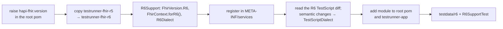

# Extending the runner

[Home](README.md) › Extending the runner

Common changes and where they go. Each recipe lists the files to touch. When you change a documented behaviour,
also update the reference document, the ADR and the matching skill in `.claude/skills/`.

## Add a configuration property

1. Add a component to the right record in `core.config` (e.g. `ExecutionConfig`).
2. Set its default in the compact constructor.
3. If a value can be invalid, add a check to `RunConfiguration.problems()`.
4. Add it to the reference in [configuration.md](../configuration.md#reference).

Spring binds it automatically (`testrunner.execution.<name>`). No Spring code changes.

## Add an assertion type

The FHIR assert types are fixed by the specification, so this is rare. More likely you make an unsupported one work.

1. `core.model.Check` – add a record (or use the existing one).
2. `fhir.hapi.TestScriptMapper.assertion` – read the element.
3. `core.engine.AssertionEvaluator` – evaluate it. Throw `AssertionFailure` for `fail`, `TestScriptException`
   for `error`.
4. The compiler now shows every exhaustive `switch` over `Check` that needs a case (`Assertion.withValues`,
   `Describe`).
5. Tests in `TestScriptExecutionTest` (nested class `Assertions`).

## Add a report format

No change in the runner needed. Implement `ReportWriter`:

```java
public final class HtmlReportWriter implements ReportWriter {
    @Override public String format() { return "html"; }
    @Override public Path write(RunResult result, Path runDirectory) throws IOException { … }
}
```

* **With Spring:** declare it as a bean. Select it with `testrunner.reporting.formats=junit,html`.
* **Without Spring:** pass it in the `TestRunner` constructor, next to `TestRunners.defaultReportWriters(…)`.

## Replace the HTTP transport

Two common cases need no code:

* A fixed token: `testrunner.fhir-server.headers`.
* An OAuth2 server: `testrunner.fhir-server.oauth2`, see
  [configuration.md › Servers protected by OAuth2](../configuration.md#servers-protected-by-oauth2).

For anything else, e.g. a proxy or mutual TLS, declare an `HttpTransport` bean. It is a functional interface.
Example: [configuration.md](../configuration.md#extending-the-pre-defined-spring-configuration).

## React to run events

Implement `RunListener` (all methods have defaults) and declare it as a bean. `testScriptFinished` may be called from
several threads at once.

## Replace the validator

Implement `ProfileValidator` and declare it as a bean. Rules:

* Thread-safe.
* Throw `ValidatorUnavailableException` when you could not validate. **Never** return a valid result then.
* If you hold processes or connections, implement `AutoCloseable`.

An in-process validator (`org.hl7.fhir.validation`) would fit here. Why it was not chosen so far:
[ADR-0006](../adr/0006-validator-cli.md).

## Add a FHIR version (R6)

Needs a HAPI FHIR release with `hapi-fhir-structures-r6`. HAPI 8.12.1, the version used now, does not have it.



Full recipe: [fhir-versions.md](../fhir-versions.md#adding-r6).

## Execute a new TestScript element

1. Add it to the neutral model in `core.model`.
2. Read it in `TestScriptMapper` – once, for all versions.
3. If its meaning differs between versions, add a method to `TestScriptDialect` with a default, and override it in
   the version that differs.
4. Use it in the engine.

## Add a test double

See [test-support](modules/testrunner-test-support.md#adding-a-double).

## Checklist before you push

* `mvn verify` is green and prints no compiler warnings.
* `ArchitectureTest` still passes – no Spring or HAPI in the core.
* The reference doc, the ADR (if a decision changed) and the skill are updated.
