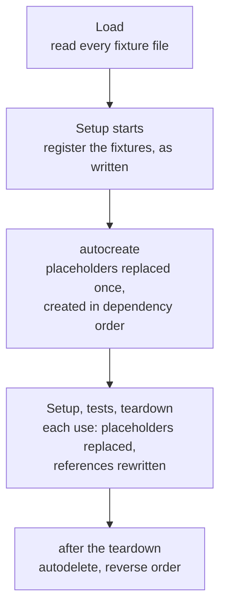

# Fixtures

[Home](README.md) › Fixtures

A fixture is a resource a TestScript works with. The TestScript declares it in `TestScript.fixture` and refers to it
by its id. This page explains where the runner finds a fixture, when it creates one on the server, and what a fixture
looks like each time it is used.

## Declaring a fixture

```json
"fixture": [{
  "id": "patient-create",
  "autocreate": false,
  "autodelete": false,
  "resource": { "reference": "Patient/HL7ATCorePatientExample" }
}]
```

| Element | Meaning |
|---|---|
| `id` | the name operations and assertions use: `sourceId`, `targetId`, `compareToSourceId`, `minimumId`, `variable.sourceId` |
| `autocreate` | create the resource on the server before the setup actions run |
| `autodelete` | delete the created resource after the teardown |
| `resource.reference` | where the resource comes from; see below |

A fixture without `resource` only reserves its id.

## Where the resource comes from

There are two places:

* **Inside the TestScript**, in `TestScript.contained`, when the reference starts with `#`.
* **In a file** in the suite's `Example_Instances/` folder, for any other reference.

### A resource contained in the TestScript

A small fixture can live in the TestScript itself. Then the TestScript is complete in one file:

```json
{
  "resourceType": "TestScript",
  "contained": [
    { "resourceType": "Patient", "id": "pat", "name": [{ "family": "Muster" }] }
  ],
  "fixture": [{
    "id": "patient",
    "autocreate": false,
    "autodelete": false,
    "resource": { "reference": "#pat" }
  }],
  …
}
```

* `#pat` names the contained resource whose `id` is `pat`.
* The resource is used in the format of the TestScript: JSON for a JSON TestScript, XML for an XML one.
* It works in R4 and R5. `contained` looks the same in both.
* If no contained resource has that id, the TestScript gets an `error` in the phase `Load`. The message lists the
  ids that exist: `… has no resource with the id 'other' (contained: [pat])`.
* After loading, a contained fixture is like any other. Placeholders, `autocreate` and `autodelete` work the same way.

### A file in Example Instances

`ExampleInstanceResolver` looks in the suite's `Example_Instances/` folder. The files are named
`<ResourceType>-<id>.json` or `.xml`. These spellings of the reference all find `Patient-Example.json`:

| Reference | Written by |
|---|---|
| `Patient/Example` | SUSHI, for `Reference(Example)` |
| `Patient-Example.html` | the IG Publisher (page name) |
| `http://example.org/fhir/Patient/Example` | an absolute URL; only the last two segments count |

If no file matches, the TestScript gets an `error` in the phase `Load`. The message lists every file tried.

## What happens when



1. **Load.** The resources are read with the TestScript, from `contained` or from the files.
2. **Register.** When the setup starts, every fixture is kept as written.
3. **Autocreate.** Fixtures with `autocreate` are sent with `POST [base]/[type]`, in dependency order. The server's
   id is kept. A rejected create makes the Setup `error` and names the request (`REQ-0003`) and the status.
4. **Use.** Every other fixture is prepared each time it is used. See the next section.
5. **Autodelete.** After the teardown, fixtures with `autodelete` are deleted, in reverse creation order. This also
   happens if the setup or a test failed.

## A fixture at each use

A fixture that is not autocreated is prepared each time it is used:

* **Placeholders** such as `${pid}` are replaced with their values at that moment. See
  [Variables and placeholders](variables.md#placeholders-in-fixture-resources).
* **References to autocreated fixtures** are rewritten to the id the server assigned.

"Used" means: sent as the body of an operation (`sourceId`), read by an assertion or a variable, compared by
`minimumId`, or named by `targetId`.

An autocreated fixture is prepared once, when it is created. After that, every use sees what was sent.

### References to autocreated fixtures

A fixture written for an IG references other examples by their ids, e.g. `Patient/pat-1`. On the server, that
Patient has another id. The runner rewrites such references for you:

| Fixture | Written | Sent |
|---|---|---|
| `patient` (autocreate) | `{"resourceType":"Patient","id":"pat-1",…}` | created as `Patient/1` |
| `obs` (sent in a test) | `"subject": {"reference": "Patient/pat-1"}` | `"subject": {"reference": "Patient/1"}` |

Rules:

* Only references to **autocreated** fixtures change. The fixture is matched by resource type and id.
* Relative and absolute references both work. `http://example.org/fhir/Patient/pat-1` becomes `Patient/1`.
* A version is dropped: `Patient/pat-1/_history/2` becomes `Patient/1`.
* `#contained` and `urn:uuid:` references stay as they are.
* Between autocreated fixtures, the same rewrite decides the creation order. A cycle is a Setup `error`.

## Errors

| Problem | Outcome |
|---|---|
| no file for `resource.reference` | `error` in phase `Load`, nothing sent |
| no contained resource for `#id` | `error` in phase `Load`, nothing sent |
| `autocreate` on content that is no FHIR resource | Setup `error` |
| two autocreated fixtures with the same type and id | Setup `error` |
| autocreated fixtures reference each other in a cycle | Setup `error`, tests `skip` |
| the server rejects an autocreate | Setup `error` with request id and status |
| a placeholder in an autocreated fixture fails | Setup `error`, tests `skip`, teardown runs |
| a placeholder in another fixture fails | the operation or assertion using it is `error` |
| an autodelete fails | Teardown `error` |

## Code map

| Class | Role |
|---|---|
| `core.model.FixtureDefinition` | one declared fixture |
| `core.source.ExampleInstanceResolver` | finds the file behind `resource.reference` |
| `core.source.TestScriptLoader` | reads the fixture resources with the TestScript: `#id` from `contained`, the rest from files |
| `core.engine.FixtureManager` | `register`, `autocreate`, `resolve` (each use), `autodelete` |
| `core.engine.ExecutionState` | keeps the fixtures as written; `find` hands them out resolved |
| `core.content.ResourceContent` | `replaceText`, `references`, `replaceReferences`, `contained` |

Tests: `TestScriptExecutionTest`, nested classes `Fixtures` and `FixtureValues`;
`ResourceContentTest.containedResourcesAreBodiesOfTheirOwn`; `EndToEndIT.fixtureFromTestScriptContainedInR4AndR5`.

The reference is [architecture.md › Execution semantics](../architecture.md#execution-semantics).
