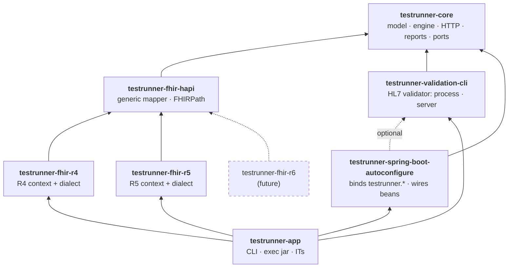

# Modules

[Home](../README.md) › Modules

The project has eight Maven modules under the parent `at.hl7.testing:testrunner-parent`. Each has one reason to
change ([ADR-0001](../../adr/0001-hexagonal-modules.md)).

`testrunner-test-support` is left out of the diagram. Every module uses it, but only in test scope.

| Module | In one sentence | Size (main code) | Page |
|---|---|---|---|
| `testrunner-core` | The engine and everything that does not depend on a framework or FHIR library. | 96 classes | [core](testrunner-core.md) |
| `testrunner-fhir-hapi` | Reads TestScripts of any FHIR version with HAPI and maps them to the core model. | 9 classes | [fhir-hapi](testrunner-fhir-hapi.md) |
| `testrunner-fhir-r4`, `-r5` | Plug in one FHIR version each: a `FhirContext` and a dialect. | 2 classes each | [fhir-r4 / r5](testrunner-fhir-versions.md) |
| `testrunner-validation-cli` | Validates resources with `validator_cli.jar`, as a process or as a server. | 7 classes | [validation-cli](testrunner-validation-cli.md) |
| `testrunner-spring-boot-autoconfigure` | Binds `testrunner.*` and wires the runner as replaceable Spring beans. | 3 classes | [autoconfigure](testrunner-spring-boot-autoconfigure.md) |
| `testrunner-app` | The executable jar, the end-to-end tests and the architecture rules. | 3 classes | [app](testrunner-app.md) |
| `testrunner-test-support` | Test doubles: in-memory FHIR server, fake validator, sample data. | test code only | [test-support](testrunner-test-support.md) |

## Base packages

All code lives below `at.hl7.testing.runner`:

| Package | Module |
|---|---|
| `core.*` | testrunner-core |
| `fhir.hapi` | testrunner-fhir-hapi |
| `fhir.r4`, `fhir.r5` | testrunner-fhir-r4, testrunner-fhir-r5 |
| `validation.cli` | testrunner-validation-cli |
| `autoconfigure` | testrunner-spring-boot-autoconfigure |
| `app` | testrunner-app |
| `testsupport` | testrunner-test-support (in `src/test/java`) |

## Which module do I touch?

| Change | Module |
|---|---|
| New assertion type, operation behaviour, phase rule | core (`engine`, `model`) |
| New TestScript element to execute | core (`model`) + fhir-hapi (`TestScriptMapper`) |
| A semantic difference between FHIR versions | fhir-hapi (`TestScriptDialect`) + the version module |
| New FHIR version | new module next to fhir-r5 |
| New report format | core (`report`) or your own `ReportWriter` bean |
| New configuration property | core (`config`) – Spring binds it automatically |
| Validator behaviour | validation-cli |
| Command line options, exit codes | app |
| A new test double | test-support |
