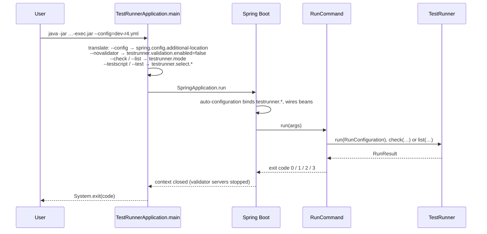

# testrunner-app

[Home](../README.md) › [Modules](README.md) › testrunner-app

The executable jar. A small Spring Boot command line application. It also hosts the end-to-end tests and the
architecture rules, since it is the only module that sees everything.

**Dependencies:** autoconfigure, fhir-r4, fhir-r5, validation-cli, `spring-boot-starter`.

## Classes

| Class | Job |
|---|---|
| `TestRunnerApplication` | `main`. Translates the short options, starts Spring Boot, exits with the exit code. |
| `RunCommand` | `ApplicationRunner`: runs (or with `--check` only checks, with `--list` only lists) the configured TestScripts once, turns the outcome into the exit code. |
| `ValidatorCheck` | Warns at start-up when validation is on but the jar or Java is missing. |

## From command line to exit code



## Command line

```sh
java -jar testrunner-app/target/testrunner-app-0.1.0-SNAPSHOT-exec.jar --config=config/dev-r4.yml
```

| Option | Short for |
|---|---|
| `--config=<file>` | `--spring.config.additional-location=file:<file>` |
| `--novalidator` | `--testrunner.validation.enabled=false` |
| `--check` | `--testrunner.mode=check`: load and check the TestScripts, send nothing ([Check mode](../../configuration.md#check-mode)) |
| `--list` | `--testrunner.mode=list`: print what would run, send and write nothing |
| `--testscript=<glob>` | `--testrunner.select.test-scripts[i]=<glob>`: run only matching TestScripts (file name, name, url); repeatable or comma-separated |
| `--test=<glob>` | `--testrunner.select.tests[i]=<glob>`: run only matching tests ([Selecting what runs](../../configuration.md#selecting-what-runs)) |
| `--testrunner.<property>=<value>` | any single property |

All properties: [configuration.md](../../configuration.md#reference).

`testrunner.run-on-startup=false` turns off `RunCommand`. Useful to embed the app or to test the wiring.

## Exit codes

`RunCommand.exitCode` turns the `RunResult` into the exit code:

| Code | When |
|---|---|
| 0 | passed |
| 1 | at least one `fail` or `error`; with `--check`: a TestScript has problems; with `--list`: a TestScript cannot be read |
| 2 | invalid configuration (`ConfigurationException`) |
| 3 | skipped TestScripts, none failed – as `testrunner.exit-on-skip` says |

A skipped TestScript tested nothing. A CI job that only sees exit code 0 would not notice that the server was missing.
So by default (`exit-on-skip: all`) a run where every TestScript was skipped exits with `3`. Use `any` to fail on a
single skip, `never` for the old behaviour:

```sh
java -jar testrunner-app-…-exec.jar --config=ci.yml --testrunner.exit-on-skip=any
```

## Defaults of the jar

`src/main/resources/application.yml` holds only defaults: no banner, no web server, console at `INFO`, all five
report formats. Real settings belong in a `--config` file. Development configurations are in
[`config/`](../../../config).

## Two jars

The build produces two artefacts ([ADR-0010](../../adr/0010-build.md)):

| Jar | Use |
|---|---|
| `testrunner-app-<version>.jar` | plain jar – a library, and what the failsafe tests use |
| `testrunner-app-<version>-exec.jar` | Spring Boot executable jar (~97 MB, mostly HAPI) |

`Dockerfile` (next to the POM) builds two container images from the exec jar, the runner alone and the runner with the
HL7 validator (`--target validator`); `docker/testrunner` is the launcher they start with; `.dockerignore` keeps
everything else out of the build context. Usage and mounts: [Build and test › Container image](../build-and-test.md#container-image),
[ADR-0015](../../adr/0015-container-image.md), [ADR-0020](../../adr/0020-published-images.md); the published images in
other pipelines: [CI integration](../ci-integration.md).

## Tests in this module

| Test | Kind | Covers |
|---|---|---|
| `TestRunnerApplicationTest` | unit | translation of the short options |
| `RunCommandTest` | unit | exit codes for every `exit-on-skip` value, the text of `--list` |
| `EndToEndIT` | failsafe | the whole app on the sample TestScripts, with an in-memory FHIR server and the fake validator; `--check` on the samples without a server; selection by file name, name and test; `--list` |
| `RealValidatorIT` | failsafe, opt-in | AT Core R4 suite incl. the negative control with the **real** validator, both modes. Runs only with `VALIDATOR_JAR` set. |
| `HapiServerIT` | failsafe, needs Docker | AT Core R4 and R5, every sample and a TestScript for two servers against **real** HAPI FHIR servers (Testcontainers, `hapiproject/hapi:v8.12.0-1`). Skipped without Docker. |
| `ArchitectureTest` | unit (ArchUnit) | the module boundaries |

`ArchitectureTest` lives here because only this module has every other module on its classpath.

## Related

* [Build and test](../build-and-test.md)
* Skills: `.claude/skills/testrunner-build-and-run`, `testrunner-configuration`
