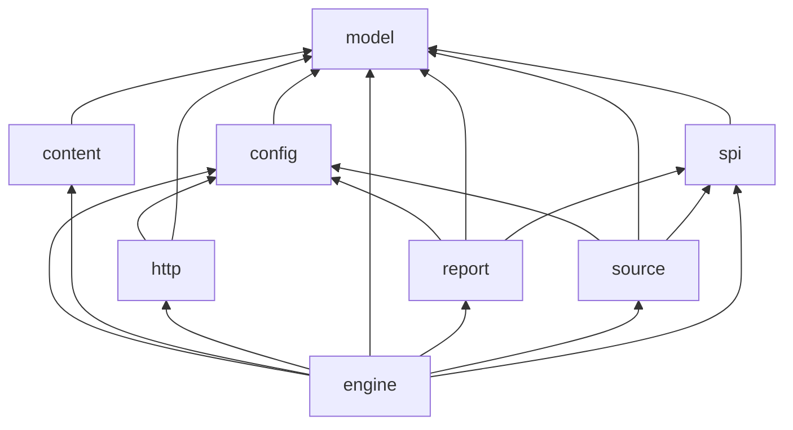
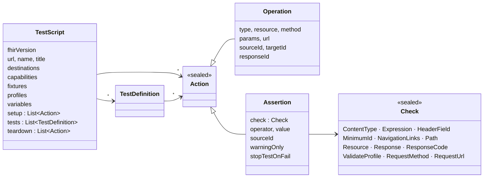

# testrunner-core

[Home](../README.md) › [Modules](README.md) › testrunner-core

The heart of the runner. It holds the model, the engine, the HTTP client, the reports, the configuration and the
ports. It is by far the largest module.

**Dependencies:** SLF4J, Jackson, Jayway JsonPath. **No** Spring, **no** HAPI, **no** Logback.
`ArchitectureTest` enforces this.

## Why the core is framework-free

* The engine can be embedded anywhere: a CLI, a Maven plugin, a web service, a test.
* Unit tests need no Spring context and no FHIR library. They use a stub FHIR version (`StubVersionSupport`).
* HAPI and Spring change on their own schedule. The core does not have to follow.

See [ADR-0002](../../adr/0002-spring-boot-at-the-edge.md).

## Packages

Package `at.hl7.testing.runner.core`. The dependencies between the packages (no cycles, enforced):



| Package | Holds | Key classes |
|---|---|---|
| `model` | The version-neutral TestScript: immutable records and enums; `TestScript`, `Operation` and `Assertion` with a `builder()`/`toBuilder()` | `TestScript`, `Action` (sealed: `Operation` \| `Assertion`), `Check` (sealed, one record per assert type), `FixtureDefinition`, `VariableDefinition`, `FhirVersion`, `Body` |
| `config` | The configuration tree, all records with defaults | `RunConfiguration`, `SuiteConfig`, `ValidationConfig`, `ReportingConfig`, … |
| `spi` | Ports to the FHIR version modules and the validator | `FhirVersionSupport`, `FhirVersionRegistry`, `FhirPathEvaluator`, `ProfileValidator`, `ValidationRequest`/`Result`, `TestReportContent` |
| `content` | Version-independent work on JSON/XML resources | `ResourceContent` (type, id, references), `FhirElement` (`minimumId` comparison), `PathEvaluator` (JSONPath/XPath) |
| `http` | The HTTP layer, OAuth2 tokens and the communication log | `FhirHttpClient`, `HttpTransport` (port), `JdkHttpTransport`, `AccessTokens`, `CommunicationLog`, `FhirRequest`/`FhirResponse`/`Exchange` |
| `source` | Finding and loading TestScripts; FHIR packages (cache, registry, CI builds, checksums) | `TestScriptDiscovery`, `TestScriptLoader`, `ExampleInstanceResolver`, `PackageSuites`, `PackageRef` |
| `engine` | Running a TestScript | `TestRunner`, `TestRunners`, `RunControl`, `RunInfo`, `RunContext`, `RunScheduler`, `ExecutionFactory`, `ReportPublisher`, `TestScriptExecution`, `ExecutionState`, `TestScriptChecks`, `ActionRules`, `Destinations`, `Servers`, `AssertionEvaluator`, `RequestFactory`, `VariableResolver`, `FixtureManager`, `CapabilityCheck` |
| `report` | Results and report writers | `Outcome`, `ActionResult`, `PhaseResult`, `TestScriptResult`, `RunResult`, `ReportWriter` (port) and its four implementations |

## The model

The model holds only what the engine executes. It is not a full copy of the FHIR resource.



Why sealed types? A FHIR assert carries **exactly one** check (invariants tst-5/tst-6). A sealed `Check` makes that
a type, not a rule to remember. `switch` over it is exhaustive: add a check type and the compiler shows every
place that must handle it.

## The engine

`TestRunner` is the entry point. It is stateless between runs and thread-safe. Its collaborators are passed in
the constructor:

```java
new TestRunner(versions, transport, validator, reportWriters, listeners, clock);
```

`TestRunners.create(httpConfig, validator)` builds one with the defaults, without Spring.

`TestRunner` checks the configuration and runs one TestScript at a time: load, check, execute. `check` stops
before execute, for authors and CI without a server; `list` says what would run. `Selection` applies
`RunConfiguration.select` to the TestScripts and tests ([ADR-0014](../../adr/0014-author-workflow.md)). Three helpers
do the rest:

| Class | Job |
|---|---|
| `RunScheduler` | which TestScript runs when: serial suites first, then the pool of `execution.parallelism` threads |
| `ExecutionFactory` | what one execution gets from its run, as an `ExecutionEnvironment`: a `FhirHttpClient` per server (`Servers`, by destination index) with the default headers and OAuth2 token of that server and the TestScript's communication log, and the `${testrunner.…}` values. Which servers those are decides `Destinations.map` ([ADR-0019](../../adr/0019-several-servers.md)) |
| `ReportPublisher` | writes the reports in the configured formats and logs the summary; no FHIR TestReports for a check |

### The public API

What other modules and an application embedding the runner may use. `ArchitectureTest.otherModulesUseOnlyThePublicApiOfTheCore`
enforces it; everything else may change without notice.

| Package | Public for other modules |
|---|---|
| `model`, `config`, `spi`, `report` | everything: the model the version modules fill, the configuration, the ports, the results |
| `engine` | `TestRunner` (with `TestRunner.Listed`, the result of `list`), `TestRunners`, `RunControl`, `RunListener`, `RunInfo`, `ConfigurationException` |
| `http` | `HttpTransport`, `JdkHttpTransport`, `FhirRequest`, `FhirResponse`, `HttpHeaders` – for a transport of your own |
| `content`, `source` | nothing |

`RunContext` – the run's request counter and OAuth2 tokens – is package-private. Listeners get a `RunInfo` with values
only ([ADR-0004](../../adr/0004-no-global-state.md)). A type that is `public` only so that another core package can
use it is not API. To use one from outside, add it to the list in `ArchitectureTest` on purpose, and to this table.

The step-by-step flow is on [How a run works](../run-lifecycle.md). The exact rules are in
[architecture.md](../../architecture.md#execution-semantics). How `${…}` placeholders are resolved is on
[Variables and placeholders](../variables.md).

### Exceptions say who must act

| Exception | Meaning | Outcome |
|---|---|---|
| `AssertionFailure` | the server did not behave as expected | `fail` |
| `TestScriptException` | the TestScript cannot be executed (unknown id, unsupported feature) | `error` |
| `ValidatorUnavailableException` | the validator could not validate at all | `error` |
| `ExchangeFailedException` | no response from the server | `error` |
| `TestScriptFormatException` | the file is no valid TestScript | `error` in phase `Load` |
| `ConfigurationException` | the run cannot start | exit code 2 |

`fail` is for the server developers. `error` is for the TestScript authors or the people running the runner.

## Version-independent content handling

Some things look the same in every FHIR version: the resource type, the id, `meta.versionId`, references. The core
handles them on the raw JSON/XML (`ResourceContent`), without a FHIR model. Only FHIRPath needs the version-specific
model; it goes through the `FhirPathEvaluator` port.

`FhirElement` reads JSON and XML into one shape. This lets `assert.minimumId` compare a JSON fixture with an XML
response. Decimals keep their precision (`100.0` ≠ `100`).

## Tests

| Test | Covers |
|---|---|
| Engine tests, one class per concern, all on `EngineTestBase`: `FixturesTest`, `OperationsTest`, `AssertionsTest`, `CapabilitiesTest`, `ReferenceRewritingTest`, `KeptRequestsTest`, `ChecksBeforeSendingTest`, `CheckModeTest`, `SelectionTest`, `PhasesTest`, `PlaceholdersTest`, `TestRunnerTest`, `RunControlTest`, `RunFolderTest`, `OAuth2Test`, `SeveralServersTest` | phase rules, operations, assertions, fixtures, capabilities, variables, kept requests, checks before sending, check mode, selection and list, parallel runs, run control, the run folder, OAuth2, TestScripts for several servers – through the real `TestRunner` with in-memory servers |
| `RunConfigurationTest` | defaults and `problems()` |
| `AccessTokensTest` | fetching and renewing OAuth2 access tokens |
| `FhirElementTest`, `PathEvaluatorTest`, `ResourceContentTest`, `UrlEncodingTest` | content helpers |
| `CommunicationLogTest`, `TestReportWriterTest`, `ExampleInstanceResolverTest`, `PackageSuitesTest` (against `FakePackageServer`: checksums, `2.1.x`, `#current`, transitive dependencies) | logs, reports, sources |

`Harness` and `Scripts` (in `src/test`) build TestScript models in code, so engine tests need no FHIR module.

## Related

* Skills: `.claude/skills/testrunner-execution-engine`, `testrunner-logging-and-reports`
* [ADR-0004: No global state](../../adr/0004-no-global-state.md)
* [ADR-0007: Logging](../../adr/0007-logging.md), [ADR-0008: Parallel execution](../../adr/0008-parallel-execution.md)
