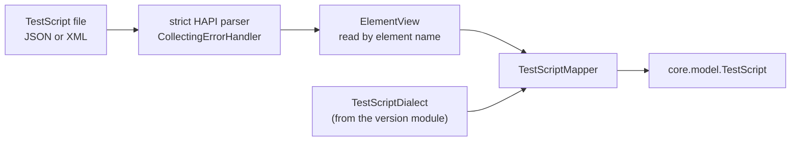

# testrunner-fhir-hapi

[Home](../README.md) › [Modules](README.md) › testrunner-fhir-hapi

Everything HAPI-based that is the **same for every FHIR version**. A version module only adds its `FhirContext` and
its dialect. This module does the rest.

**Dependencies:** core, `hapi-fhir-base`, `ucum`, `hapi-fhir-caching-caffeine`. **Not** `hapi-fhir-structures-r4`
or `-r5` – the build forbids the version-specific packages here (`ArchitectureTest`).

## What it does



| Class | Job |
|---|---|
| `HapiFhirVersionSupport` | Abstract base of every version module. Implements the `FhirVersionSupport` port: check, read, FHIRPath, TestReport. |
| `CollectingErrorHandler` | Collects parser problems instead of failing on the first. Wrong types → *errors*. Unknown elements → *warnings*. |
| `ElementView` | Reads a HAPI model by element name (`children("fixture")`, `string("url")`). An element that does not exist in a version reads as absent. |
| `TestScriptMapper` | **One** mapper for all versions. Turns an `ElementView` into the core model. |
| `TestScriptDialect` | Interface for the *semantic* differences between versions. Each version module implements it. |
| `ResponseCodes` | Maps every `assert.response` code of every version to its HTTP status. |
| `HapiFhirPathEvaluator` | FHIRPath with the HAPI engine of the right version. |
| `ModelOnlyValidationSupport` | Lets FHIRPath run on the model alone, without loading the whole specification. |
| `TestReportEncoder` | Writes a FHIR `TestReport` by element name, for any version. |

## The key trick: reading by name

R4 and R5 TestScripts are ~95 % identical. Writing one mapper per version on typed HAPI classes would copy that
95 %. Instead, `ElementView` reads elements by name through HAPI's runtime definitions:

```java
testScript.children("fixture")        // works for R4 and R5
assertion.bool("stopTestOnFail", …)    // absent in R4 → the default
```

Type-only differences are absorbed in one code path:

| Element | R4 | R5 | Handled by |
|---|---|---|---|
| `TestScript.profile` | `Reference` with `id` | `canonical`, id on `_profile` | `ElementView.isPrimitive()` + `elementId()` |
| `operation.resource` | `code` | `uri` | reduced to the type name |
| `assert.response` | `bad`, `unprocessable`, … | `badRequest`, `unprocessableContent`, … | `ResponseCodes` table |

The full comparison and the reasoning: [fhir-versions.md](../../fhir-versions.md).

## Version detection

`check(content)` parses the file strictly and returns a `ReadCheck` with errors and warnings. The core's
`FhirVersionRegistry.detect` asks every version and picks:

1. only versions without errors,
2. the fewest warnings,
3. on a tie, the newest.

The dialect can add warnings where HAPI would accept both versions. Example: an R4 profile `Reference` also parses
as an R5 `canonical` with an id but no value. `R5Dialect` flags that.

## FHIRPath

`HapiFhirPathEvaluator` evaluates `assert.expression` and `variable.expression` with the model of the TestScript's
version. Two details:

* `ModelOnlyValidationSupport` replaces HAPI's default validation support. The default would load the whole
  specification (24 MB for R5 alone). FHIRPath on concrete resources needs only the model.
* `X.resourceType` is rewritten to `X.type().name`. It is no FHIR element, so a spec-conformant engine returns
  empty. The Python PoC returned the JSON property, and existing TestScripts rely on it.

## Why the context must be your own

`HapiFhirVersionSupport` installs `ModelOnlyValidationSupport` on the `FhirContext`. So the context must be a new one
(`FhirContext.forR4()`), not the shared cached one (`forR4Cached()`). Otherwise the change leaks into other code.

## Tests

No tests of its own. `R4SupportTest` and `R5SupportTest` in the version modules map every sample TestScript and
cover detection. Since element names are strings, these tests are what catches a typo.

## Related

* [fhir-versions.md](../../fhir-versions.md) – the full story, including the R6 recipe
* [ADR-0005: FHIR version mapping](../../adr/0005-fhir-version-mapping.md)
* Skill: `.claude/skills/testrunner-fhir-versions`
