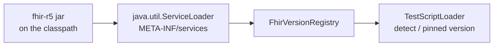

# testrunner-fhir-r4 and testrunner-fhir-r5

[Home](../README.md) › [Modules](README.md) › testrunner-fhir-r4 / -r5

One module per FHIR version. Each is tiny on purpose.

| Module | Classes | Lines | Adds |
|---|---|---|---|
| `testrunner-fhir-r4` | `R4Support`, `R4Dialect` | 27 | `hapi-fhir-structures-r4` |
| `testrunner-fhir-r5` | `R5Support`, `R5Dialect` | 44 | `hapi-fhir-structures-r5` |

## Anatomy of a version module

```
testrunner-fhir-r5/
├─ pom.xml                          depends on testrunner-fhir-hapi + hapi-fhir-structures-r5
└─ src/main/
   ├─ java/…/fhir/r5/
   │  ├─ R5Support.java             FhirVersion + FhirContext + dialect
   │  └─ R5Dialect.java             semantic differences of R5
   └─ resources/META-INF/services/
      └─ at.hl7.testing.runner.core.spi.FhirVersionSupport   → names R5Support
```

`R5Support` in full:

```java
public final class R5Support extends HapiFhirVersionSupport {
    public R5Support() {
        super(FhirVersion.R5, FhirContext.forR5(), new R5Dialect());
    }
}
```

## How a version module is found



No code names the module. Putting the jar on the classpath is all it takes. Without Spring,
`FhirVersionRegistry.fromServiceLoader()` collects them. With Spring, the auto-configuration does the same and also
accepts `FhirVersionSupport` beans.

## The dialects

| Dialect | Content |
|---|---|
| `R4Dialect` | empty – the defaults fit R4 (`stopTestOnFail` does not exist, so a failure never stops the test) |
| `R5Dialect` | one check: a profile without a canonical value is an R4 `Reference` in disguise → warning |

The dialect interface (`TestScriptDialect` in fhir-hapi) is the **one place** to look for "what differs between
versions". Each method has a comment naming the element and versions.

## Rules

* The version modules must not know each other (`ArchitectureTest`).
* A version module has no Spring dependency.

## Tests

`R4SupportTest`, `R5SupportTest` – every sample TestScript of the version maps exactly, and the detection cases
of [fhir-versions.md](../../fhir-versions.md#version-detection) hold.

## Adding R6

Copy `testrunner-fhir-r5`, swap the context and dialect, register the module. `FhirVersion.R6` already exists in the
core. The recipe with all steps: [fhir-versions.md – Adding R6](../../fhir-versions.md#adding-r6). A short version is
on [Extending the runner](../extending.md#add-a-fhir-version-r6).
