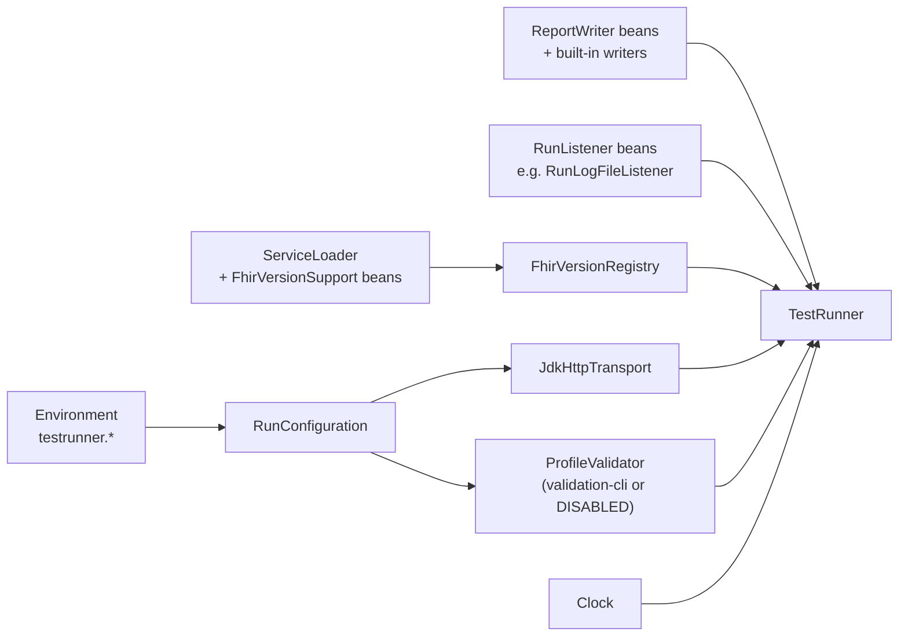

# testrunner-spring-boot-autoconfigure

[Home](../README.md) › [Modules](README.md) › testrunner-spring-boot-autoconfigure

The pre-defined Spring configuration. It binds the `testrunner.*` properties to a `RunConfiguration` and wires a
`TestRunner`. Every bean can be replaced.

**Dependencies:** core, `spring-boot-autoconfigure`. Optional: `testrunner-validation-cli`, `logback-classic`.

## Classes

| Class | Job |
|---|---|
| `TestRunnerAutoConfiguration` | Binds the configuration. Defines the registry, transport, validator fallback, clock and `TestRunner` beans. |
| `ValidatorCliAutoConfiguration` | Defines the HL7 validator as `ProfileValidator`, if validation-cli is on the classpath. Runs **before** the main configuration. |
| `RunLogFileListener` | A `RunListener` that attaches `testrunner.log` to each run folder. Only with Logback. |

Both auto-configurations are registered in
`META-INF/spring/org.springframework.boot.autoconfigure.AutoConfiguration.imports`.

## The beans



| Bean | Default | `@ConditionalOnMissingBean` |
|---|---|---|
| `RunConfiguration` | bound from `testrunner.*` | yes |
| `FhirVersionRegistry` | `FhirVersionSupport` beans + `ServiceLoader` modules | yes |
| `HttpTransport` | `JdkHttpTransport` (closed with the context) | yes |
| `ProfileValidator` | validation-cli by `mode`, else `DISABLED` | yes |
| `Clock` | system clock | yes |
| `TestRunner` | all of the above + every `ReportWriter` and `RunListener` bean | yes |
| `RunLogFileListener` | only with Logback | yes |

**Lists add, singletons replace.** Declare your own `HttpTransport` and it replaces the default. Declare a
`ReportWriter` or `RunListener` and it is added. A `ReportWriter` with a built-in format name replaces that built-in.

Examples: [configuration.md](../../configuration.md#extending-the-pre-defined-spring-configuration).

## Binding without annotations on the core

`RunConfiguration` is a plain record in the framework-free core. It has no `@ConfigurationProperties`. The
auto-configuration binds it with Spring's `Binder`:

```java
Binder.get(environment).bind("testrunner", RunConfiguration.class)
```

The binder fills records through their constructor. So relaxed names, environment variables, profiles and duration
conversion all work, and the core stays free of Spring. See [ADR-0002](../../adr/0002-spring-boot-at-the-edge.md).

One guard: the old property `testrunner.validation.igs` moved to `suites[n].igs`. The binder ignores unknown
properties, so the configuration rejects the old one explicitly. Otherwise IGs would silently stop loading.

## The run log file

`RunLogFileListener` adds a Logback `FileAppender` when a run starts and removes it when the run ends:

* File: `<run folder>/testrunner.log`.
* Level: `testrunner.reporting.log-file-level` (default `DEBUG`), independent of the console.
* Pattern contains `[%X{testScript}]`, so lines of parallel TestScripts stay apart.

With another logging backend, the bean is not created. The console log and the communication folder still work.

## Lifecycle of the validator

In server mode the `ProfileValidator` bean holds processes. It is `AutoCloseable`, so Spring stops the validator
servers when the context closes. One server set serves all runs of the application.

## Tests

`TestRunnerAutoConfigurationTest` uses `ApplicationContextRunner`. It covers binding, defaults, and replacing and
adding beans.

## Related

* [configuration.md](../../configuration.md) – every property
* [ADR-0003: Configuration](../../adr/0003-configuration.md)
* Skill: `.claude/skills/testrunner-configuration`
