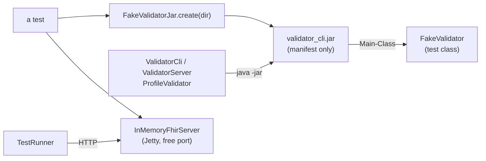

# testrunner-test-support

[Home](../README.md) › [Modules](README.md) › testrunner-test-support

Shared test doubles. They let every test run **without a FHIR server, without network and without the real
validator** ([ADR-0009](../../adr/0009-testing.md)).

## Unusual layout, on purpose

The doubles are test code. They live in `src/test/java`, and the module publishes them as a **test-jar**
(classifier `tests`). The main jar is empty.

```xml
<dependency>
    <groupId>at.hl7.testing</groupId>
    <artifactId>testrunner-test-support</artifactId>
    <type>test-jar</type>
    <classifier>tests</classifier>
    <scope>test</scope>
</dependency>
```

Why this way?

* Tools like SonarQube treat `src/test/java` as tests. The doubles are not counted as production code.
* The module does **not** depend on the core. So the core's own tests can use it too.
* The enforcer fails the build if any module uses it outside `test` scope. The doubles never reach the exec jar.
* Its own dependencies (Jackson, Jetty) are in **compile** scope. Maven passes a test-jar's compile dependencies on
  to its users; test-scoped ones it would not.

## The doubles

| Class | What it is |
|---|---|
| `InMemoryFhirServer` | A real HTTP server (Jetty) on a free local port with enough FHIR behaviour: create, read, vread, update, delete, search, history, metadata, batch/transaction. Tests use the real HTTP client and communication log. `on(…, Answer.bytes(…))` answers with raw bytes, e.g. a PDF; `requests()` keeps the bytes received. |
| `FakeValidatorJar` | Writes a `validator_cli.jar` that is only a manifest. Its `Main-Class` is `FakeValidator`, its `Class-Path` points at the test classes. The adapters start it with `java -jar`, like the real one. |
| `FakeValidator` | Behaves like the HL7 validator in process mode (`-output`) and server mode (`/validateResource`, `/stop`). Markers in the resource text simulate invalid resources, a silent validator, a crash or a hang. |
| `FakePackageServer` | A package registry (`/registry/<name>` with `dist.shasum`, a redirect to `/cdn/…tgz`) and a CI build server (`/ci/ig/qas.json`, `package.manifest.json`, `package.tgz`) on a free local port (Jetty). `publish(…)` and `build(…)` add packages, `archive(…)` builds a `.tgz`, `publish(…, shasum)` lists a wrong checksum; `requests()` lists the paths asked for. |
| `SampleData` | Finds `testdata/` from the working directory: `r4()`, `r5()`, `samples()`. |



The markers and settings of the fake validator are listed in the skill `.claude/skills/testrunner-testing`.

## Limits

* The in-memory server is not a real FHIR server. Search semantics or conditional delete rules of a real server are
  not covered here. `HapiServerIT` in `testrunner-app` covers them for the samples, against HAPI FHIR in Docker (see
  [Build and test › Against a real FHIR server](../build-and-test.md#against-a-real-fhir-server)).
* In one respect the in-memory server is stricter than HAPI: a conditional update whose body names an id other than
  the match is a `400`, as one rule of the specification says. HAPI ignores that id. Keep such checks here.
* The fake validator jar uses absolute class path entries. It works only on the machine and in the test run that
  created it.

## Adding a double

Put it into `testrunner-test-support/src/test/java/at/hl7/testing/runner/testsupport/`. Add the dependencies it
needs to this module's POM in compile scope. Use only Java SE and Jetty (no `com.sun.net.httpserver`; the compiler
rejects it).
