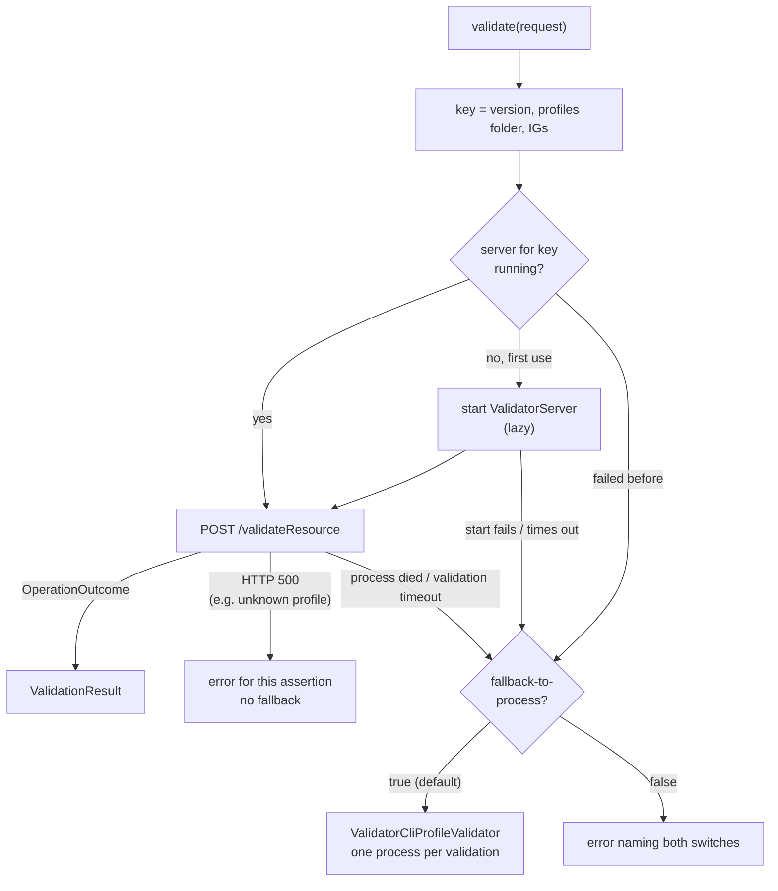

# testrunner-validation-cli

[Home](../README.md) › [Modules](README.md) › testrunner-validation-cli

Profile validation with the **HL7 FHIR Validator CLI** (`validator_cli.jar`). Implements the `ProfileValidator`
port of the core.

**Dependencies:** core only. The validator is an external jar (~200 MB). It is started as a separate Java process,
never loaded into the runner's JVM.

## Two modes

| | `process` | `server` (default) |
|---|---|---|
| Class | `ValidatorCliProfileValidator` | `ValidatorServerProfileValidator` + `ValidatorServer` |
| How | one `java -jar validator_cli.jar …` per validation | one long-running `validator_cli.jar server <port>`, `POST /validateResource` per validation |
| Cost | 5–15 s per validation | 5–7 s once, then 0.1–0.5 s per validation |
| Isolation | nothing shared | one JVM per server key |

`ProfileValidators.create(validationConfig)` picks the class by `testrunner.validation.mode`.

## Classes

| Class | Job |
|---|---|
| `ProfileValidators` | Factory: `DISABLED`, process or server, by configuration. Also `problems()` for start-up checks. |
| `ValidatorCliProfileValidator` | Process mode. Writes the resource to a temp folder, runs the validator, reads the result from `-output`. |
| `ValidatorServerProfileValidator` | Server mode. Keeps one `ValidatorServer` per key. Falls back to process mode when a server fails. `AutoCloseable`. |
| `ValidatorServer` | One validator server process: start on a free port on `127.0.0.1`, wait until ready, validate, stop. |
| `ValidatorArguments` | Builds the arguments shared by both modes: `-version`, `-tx`, `-locale`, `-ig …`, extra arguments. Also the problems: `configurationProblems` (no `validator-jar`, the run does not start) and `problems` (jar or java missing, each validation is an error). |
| `OperationOutcomeReader` | Reads the validator's OperationOutcome into a `ValidationResult`. |
| `ProcessRunner` | Runs a process with a timeout; replaceable in tests. |

## Server mode in detail

A validator server is bound to the settings it starts with. So there is one server per
**FHIR version × profiles folder × IGs** – in practice one per suite and version.

Rules worth knowing:

* A failed server is **not restarted**. An input that crashes it would otherwise cause a restart loop.
* A server answers one request at a time. Parallel TestScripts queue on it.
* A hanging validation ends the server after `validation.timeout`. Its validations then fall back.
* Servers are stopped when the application ends (`POST /stop`, then process termination). A JVM shutdown hook covers
  crashes of the runner.

Measurements and the full failure table: [ADR-0011](../../adr/0011-validator-server-mode.md).

## Never a silent pass

The Python PoC parsed the validator's console output. An empty output looked like success. Here:

* The result comes from the **OperationOutcome file** (`-output`) or the server's HTTP response.
* No file, no response, a timeout → `ValidatorUnavailableException` → `error`.
* Validation disabled → `ProfileValidator.DISABLED` → `validateProfileId` is reported as a **warning**.

The negative control (`config/negative-control.yml`) proves validation runs: it is **expected to fail**. See
[validation.md](../../validation.md#the-negative-control).

## Where the profiles come from

Each validation of a suite gets `-ig <profiles-dir>` and one `-ig` per entry of the suite's `igs`. A suite read from
a FHIR package gets the package and its dependencies. Details: [validation.md](../../validation.md#where-the-profiles-come-from).

## Thread safety

* Process mode: each validation has its own process and temp folder.
* Server mode: servers live in a `ConcurrentHashMap`; each `ValidatorServer` synchronizes its own lifecycle.

## Tests

| Test | Covers |
|---|---|
| `ValidatorCliProfileValidatorTest` | arguments, `-output` parsing, a validator that writes nothing |
| `ValidatorServerProfileValidatorTest` | one server per key, parallel use, crash, start failure, slow start, hang, fallback on/off, stop on close |

Both use `FakeValidatorJar` from [test-support](testrunner-test-support.md). `RealValidatorIT` in the app module
runs the real validator, opt-in.

## Related

* [validation.md](../../validation.md) – setup, modes, silent-pass protection
* [ADR-0006](../../adr/0006-validator-cli.md) (process mode), [ADR-0011](../../adr/0011-validator-server-mode.md) (server mode)
* Skill: `.claude/skills/testrunner-validation`
