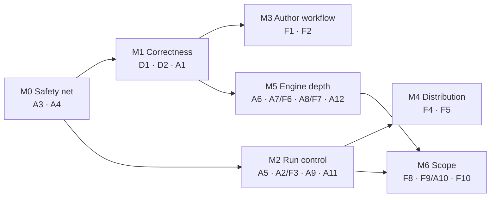

# Next steps

[Home](README.md) › Next steps

An architecture review of the runner as of 2026-11-05 (commit `58ee953`), the features worth building next, and a
plan for both. The review covered every module. `mvn verify` was green with 192 tests.

Every item has an id, so that tickets, commits and ADRs can refer to it: **D** = defect, **A** = architecture
finding, **F** = feature.

## Summary

The architecture is sound and needs no structural change. The core is framework-free and the build enforces its
boundaries. Every piece of state has an owner, results are immutable, `fail` and `error` are kept apart, and every
path to a silent pass is closed. The weak spots are smaller:

1. **Two defects.** A conditional update sends a wrong resource id (D1). An assertion whose operator does not fit
   its check is reported only after requests have changed server data (D2).
2. **Validation rules live in three places.** The evaluator, the request factory and the pre-run checks each know
   part of what makes a TestScript valid. That is the cause of D2 (A1).
3. **A run cannot be bounded or cancelled.** If a run is killed or crashes, it writes no reports. This hurts most in
   CI (A2).
4. **No CI pipeline and no test against a real FHIR server.** The in-memory server knows only a little FHIR: it
   ignores search semantics and did not answer conditional updates at all (A3, A4).

The feature with the best value for its effort is a **check mode** (F1). It loads and checks TestScripts without a
server. Every check it needs already exists. TestScript authors, and the TinkerTool that writes TestScripts, would
get feedback in seconds.

## What should stay

Keep these properties. Any change below has to preserve them.

| Property | Where it is enforced |
|---|---|
| Framework-free core, adapters as modules | `ArchitectureTest`, `--limit-modules java.se`, enforcer |
| No global state; run state in `RunContext`, TestScript state in `ExecutionState` | [ADR-0004](../adr/0004-no-global-state.md), code review |
| One generic mapper plus a tiny dialect per FHIR version | [ADR-0005](../adr/0005-fhir-version-mapping.md) |
| Typed checks: sealed `Check` with exhaustive switches | the compiler |
| Never a silent pass; `fail` ≠ `error` | [Design insights §7, §8](design-insights.md#7-never-a-silent-pass) |
| Everything that fails in every run is reported before anything is sent | `TestScriptChecks` (but see D2) |
| Every exchange traceable by request id | `FhirHttpClient`, `CommunicationLog` |

## Defects

Both were reproduced with a probe test against `InMemoryFhirServer`. The probe test was deleted afterwards.

### D1 – Conditional update sends the resource type as id

**Status:** fixed. `RequestFactory` sets the body id only for an instance URL; test
`TestScriptExecutionTest.Operations.conditionalUpdateSendsTheFixtureAsWritten`.

**What happened.** An `update` with `params: "?identifier=…"` is a conditional update (`PUT [base]/[type]?[search]`).
The runner sends it with the body's `id` replaced by `Patient`.

**Why.** `RequestFactory.create` sets the body id to the last path segment of the URL for every update. It does this
so that `PUT [type]/[id]` and the body agree. In a conditional update the last segment is the resource type.

**Effect.** The specification is ambiguous here. One rule says an id in the body that differs from the matched
resource is a `400 Bad Request`; another says the server shall ignore the id. A server that follows the first rule
rejects the request, so the TestScript fails for a reason that is not the server's fault. HAPI FHIR 8.12 follows the
second: it ignores the id, answers `201` or `200`, and the defect is invisible there (checked with
`hapiproject/hapi:v8.12.0-1`, also with the old code). Either way the runner sent something the TestScript did not
say.

**Fix.** Only set the id when the URL is an instance URL: the path after `[base]` is exactly `[type]/[id]`, and
`[type]` is the resource type of the body. Otherwise send the body unchanged.

### D2 – Operator and operation mistakes are found after requests were sent

**Status:** fixed together with A1. `ActionRules` holds the rules; `TestScriptChecks` applies them before anything
is sent. Tests: `TestScriptExecutionTest.Checks` (`operatorTheCheckDoesNotAllowIsFoundBeforeTheSetup`,
`operatorWithoutTheValueItNeeds`, `operationsThatCannotBeBuilt`, `operationsWhoseValuesAreOnlyKnownWhenTheyRunAreAccepted`).

**What happened.** An assertion with an operator its check does not allow, such as `contentType` with `greaterThan`,
becomes an `error` only when the assertion runs. By then the setup has created fixtures and earlier operations have
changed server data. The probe showed Setup `pass`, one request sent, Test `error`.

The same applies to operations that can never be built:

* `create` or `search` with `targetId`
* `create`, `transaction` or `batch` with `params`
* an unknown operation type without `method`
* no `url`, `params`, type or resource
* an operator that needs a value (`equals`, `in`, …) without `value` or `compareToSourceId`

**Why it matters.** The docs promise that everything that fails in every run is reported before anything is sent
([How a run works › Checks before sending](run-lifecycle.md#6-checks-before-sending)). These cases break that
promise.

**Fix.** See A1.

## Architecture findings

| Id | Finding | Impact | Effort |
|---|---|---|---|
| A1 | Validation rules are spread over `AssertionEvaluator`, `RequestFactory` and `TestScriptChecks` | high – cause of D2 | M |
| A2 | A run cannot be bounded, cancelled or partially reported | high – CI | M |
| A3 | No CI pipeline; build gates only run locally | medium | S |
| A4 | No test against a real FHIR server | medium | M |
| A5 | `TestRunner` does too much; `TestScriptExecution` takes 10 constructor parameters | medium | M |
| A6 | Wide positional records: `Operation` has 17 components | medium | M |
| A7 | Assertion values are compared as text | medium | M |
| A8 | Request and response bodies are `String`s | medium | M |
| A9 | The public API of the core is undefined; `RunContext` hands mutable run state to listeners | medium | S |
| A10 | Package download: new `HttpClient` per download, no proxy, no integrity check | low | S |
| A11 | `TestRunner` filters configuration problems by property-name prefix | low | S |
| A12 | A body is parsed again for every assertion and variable | low | S |

Effort: S ≤ 1 day, M 2–5 days, L more than a week.

### A1 – One place for the rules

**Status:** done, as `core.engine.ActionRules`. The run-time checks stay in `AssertionEvaluator` and
`RequestFactory` for values that are only known when an action runs.

The allowed operators of each check exist only as arguments of `AssertionEvaluator.operator(...)`. The shape rules
of operations exist only in `RequestFactory.check`, `method` and `url`. `TestScriptChecks` cannot reuse them, so it
does not check them.

**Recommendation.** Add one rule class in `core.engine`, for example `ActionRules`:

* `Operator defaultOperator(Check)` and `Set<Operator> allowedOperators(Check)` – a sealed switch, so a new check
  does not compile without its rules.
* `List<String> problems(Operation)` – the parts of `RequestFactory`'s checks that do not depend on values at run
  time. A field containing `${` is skipped, as `TestScriptChecks` already does for ids.

`AssertionEvaluator`, `RequestFactory` and `TestScriptChecks` all use it. The run-time checks stay as a safety net
that should never fire.

### A2 – Run control

* No run timeout, no per-TestScript timeout, no fail-fast. A server that answers slowly holds the run for
  `request-timeout` × requests.
* `TestRunner.runAll` waits on its futures without a deadline.
* If anything unexpected is thrown, `TestRunner.run` reports `runFinished` with an empty result and writes **no
  reports**. A CI job that is killed on a timeout leaves no `junit.xml`. The results of the TestScripts that did
  finish are lost.

### A3 – CI and build gates

The remote is GitHub, but there is no workflow. ArchUnit, the enforcer and "no compiler warnings" only protect the
code when someone runs `mvn verify`. Warnings are banned by convention only: `-Xlint:all` is set, `-Werror` is not.
There is no coverage report, no static analysis and no dependency or SBOM scan. Spring Boot plus HAPI is a large
dependency tree.

### A4 – Tests against a real server

[ADR-0009](../adr/0009-testing.md) accepts that the in-memory server is not a FHIR server. That was right for fast,
offline unit tests. But nothing runs the sample suites against a real server automatically, so the samples' claims
about server behaviour (referential integrity, conditional delete with several matches, content types) are never
checked. Two smaller points:

* 71 of the 192 tests sit in one 1,180-line class, `TestScriptExecutionTest`. (Split in M1.5.)
* ADR-0009 still says "~115 tests".

### A5 – Orchestration

`TestRunner` (376 lines) does seven jobs: configuration problems, package resolution, the run folder, discovery,
serial and parallel scheduling, the wiring of each TestScript (communication log, headers, OAuth2, built-in values),
TestScript validation, and the reports. A2 and F3 add more to exactly this class. Split it first:

* `RunScheduler` – serial suites first, then the pool; deadlines; cancellation.
* `ExecutionFactory` – builds the `FhirHttpClient`, `CommunicationLog` and built-in values of one TestScript.
* `ReportPublisher` – writes the reports and logs the summary.

`TestScriptExecution` should take one `ExecutionEnvironment` record instead of 10 parameters.

### A6 – Wide records

`Operation` has 17 positional components, `Assertion` 12, `TestScript` 13 and `SuiteConfig` 11. `new Operation(`
appears at 7 places, and the test builder `Scripts` copies all 17 arguments for every `with…` helper. Every new
element – R6 will bring some – touches all of them. Builders or `with…` methods on the records keep the records
immutable but make the call sites independent of the component order.

### A7 – Text comparison

`Operators.apply` compares strings. `greaterThan` and `lessThan` try numbers and otherwise compare text
lexicographically. So:

* `2026-01-01T10:00:00+01:00` and `2026-01-01T09:00:00Z` are the same instant, but `equals` fails and `greaterThan`
  gives the wrong answer.
* `equals` on `1.0` and `1.00` fails, although they are equal numbers. (For a FHIR decimal this is sometimes wanted,
  because the precision is part of the value.)

FHIRPath already returns typed values. Today `Values.text` throws the types away.

### A8 – Bodies as text

`JdkHttpTransport` decodes every response as UTF-8. `FhirRequest`, `FhirResponse` and `Body` hold `String`s. A
`Binary` read with its native content type – a PDF or an image, as in IHE MHD *Retrieve Document* – is corrupted in
memory and in the communication log.

### A9 – Public API

The core has no `module-info` and no list of supported types. Everything public is API by accident. In particular,
`RunListener` receives `RunContext`. That is a public record with the run's `AtomicInteger` request counter and the
`ConcurrentMap` of OAuth2 token sources, so a listener can change run state. That contradicts ADR-0004. Hand
listeners a read-only `RunInfo` (run id, start, run folder, configuration) instead. Name the supported packages in an
ArchUnit rule or a `module-info`.

### A10 – Package download

`PackageSuites.httpDownload` creates a `HttpClient` per download and never closes it. It uses neither the proxy nor
the TLS settings that apply to the FHIR server, and it does not verify the tarball. npm-style registries list a
`dist.shasum` per version; check that packages.fhir.org provides it, then verify downloads against it. A package's
TestScripts are sent to servers, so the integrity of the package matters.

### A11 and A12 – Small things

* `TestRunner.run` removes problems whose text starts with `testrunner.validation.validator-jar` when validation is
  off. The engine knows an adapter's property name and matches on message text. Let the validator adapter report its
  own configuration problems, or make problems records with a property name.
* `HapiFhirPathEvaluator` parses the body and creates a FHIRPath engine for every evaluation. `PathEvaluator` and
  `FhirElement` parse again. Ten assertions on a large search Bundle parse it ten times. Measure first; if it
  matters, cache the parsed forms per response within an `ExecutionState` (not globally).

## Features

| Id | Feature | Value | Effort | Depends on |
|---|---|---|---|---|
| F1 | **Check mode**: load and check TestScripts without a server | high | S | A1 |
| F2 | **Select what runs**: by TestScript and test name; list mode | high | S | – |
| F3 | **Run control**: run and TestScript timeouts, fail-fast, reports after Ctrl-C | high | M | A2, A5 |
| F4 | **Container image** and a compose file with HAPI FHIR | medium | S | – |
| F5 | **HTML report** linking into `communication/` | medium | M | – |
| F6 | **Typed comparisons** for dates, numbers and booleans | medium | M | A7 |
| F7 | **Binary content** in requests and responses | medium | M | A8 |
| F8 | **Several servers**: map `destination` to configured servers | medium | L | A5, ADR |
| F9 | **Packages**: `#current`, transitive dependencies | low | M | A10 |
| F10 | **FHIR R6** | later | M | a HAPI release with `hapi-fhir-structures-r6` |

**F1 – Check mode.** `--check` runs discovery, loading, `TestScriptChecks` and, if enabled, TestScript validation.
It sends nothing and needs no `fhir-server`. It writes the usual summary and JSON report, so other tools can read the
result, and exits with 0 (all valid), 1 (problems) or 2 (configuration). Use cases: TestScript authors, IG CI before
publishing, and the TinkerTool.

**F2 – Select what runs.** `--testscript=<glob>` matches file name, `TestScript.name` or `url`. `--test=<name>`
selects tests; setup and teardown always run. `--list` prints what would run. Today, the only way to select is to
edit `suites[n].include`.

**F3 – Run control.** `execution.timeout`, `execution.testscript-timeout` and `execution.fail-fast`. Deadlines are
checked between actions; a thread is never killed. TestScripts that did not run are `skip` with the reason. Reports
are always written, also after an unexpected exception or Ctrl-C.

**F4 – Container image.** The Python PoC has a Dockerfile and a compose file with HAPI FHIR; the Java runner has
neither. Use `spring-boot:build-image` or a Dockerfile on a Java 25 JRE. The validator jar and the package cache are
volumes, not part of the image.

**F5 – HTML report.** One self-contained page per run: TestScripts, phases, actions, messages, and every request id
as a link to its folder in `communication/`. For readers who do not open `junit.xml`. Opt-in as format `html`; the
[Extending](extending.md#add-a-report-format) page already sketches it.

**F8 – Several servers.** TestScripts with several `destination`s are rejected today
([architecture.md › Open points](../architecture.md#open-points)). Mapping each destination index (or its profile
code) to a configured server would run them. It changes the "one client, one server" model, so it needs an ADR
first.

## Plan

M0 and M1 come first: they protect everything after them. M2 and M3 are independent and can run in parallel. Each
step below is one pull request, with tests and documentation.

### M0 – Safety net (S)

1. ~~**CI workflow**~~ Done: `.github/workflows/build.yml`, job `verify` – Temurin 25, `mvn -B verify`, Maven cache,
   test reports kept on failure.
2. ~~**Nightly validator job**~~ Done: job `real-validator` – pinned and cached `validator_cli.jar` 7.0.2,
   `RealValidatorIT` in both modes, so the negative control is checked every night.
3. ~~**`-Werror`**~~ Done: `failOnWarning` in the compiler plugin of the root `pom.xml`, so the "no warnings" rule
   of [ADR-0010](../adr/0010-build.md) is enforced.
4. ~~**Reports, not gates**~~ Done: JaCoCo coverage report (aggregated in `testrunner-app`), CycloneDX SBOM of the
   executable jar, both kept by CI; Dependabot for Maven and GitHub Actions. No thresholds.
5. ~~Correct the test count in ADR-0009.~~ Done.

*Done when:* a pull request shows a green build, and a compiler warning turns it red.

### M1 – Correctness (S–M)

1. ~~**D1.**~~ Done: in `RequestFactory.create`, the body id is set only for an instance URL
   (`ResourceContent.parseLocation`, the type equals the body's resource type). `InMemoryFhirServer` answers
   conditional updates.
2. ~~**A1 + D2.**~~ Done: `ActionRules`, used by `AssertionEvaluator`, `RequestFactory` and
   `TestScriptChecks.References.check`. Every case listed under D2 is a `Load` error naming test and action, with
   nothing sent.
3. **Decide** how unsupported checks (`requestMethod`, `requestURL`, `manualEval`) are reported. Proposal: keep
   `error` at run time, as documented, and add a warning on the Setup before the run so the author sees it early.
4. ~~**A4.**~~ Done: `HapiServerIT` in `testrunner-app`, Testcontainers from the Spring Boot BOM,
   `hapiproject/hapi:v8.12.0-1` for R4 and R5. It runs the AT Core suites, every sample and a conditional update,
   and is skipped without Docker; CI runs it on every push.
5. ~~Split `TestScriptExecutionTest` along its nested classes into one class per concern.~~ Done: twelve classes
   on a common `EngineTestBase` (server, `Harness`, `PATIENT`, `ORGANIZATION`, `phase`), e.g. `OperationsTest`,
   `ChecksBeforeSendingTest`, `TestRunnerTest`; the largest has 243 lines.

*Docs:* [architecture.md › Execution semantics](../architecture.md#execution-semantics),
[How a run works](run-lifecycle.md), skill `testrunner-execution-engine`.
*Done when:* the D2 probe reports a `Load` error and sends nothing, and `HapiServerIT` is green in CI.

### M2 – Run control (M)

1. **A5.** Extract `RunScheduler`, `ExecutionFactory` and `ReportPublisher` from `TestRunner`. Replace the
   constructor parameters of `TestScriptExecution` with an `ExecutionEnvironment` record. Pure refactoring: no
   behaviour change, no test change apart from the wiring.
2. **A11.** Move the validator-jar exception out of `TestRunner`: `ProfileValidator` (or `ProfileValidators`)
   reports its own configuration problems.
3. **A2 + F3.** `ExecutionConfig.timeout`, `testScriptTimeout` and `failFast`, with defaults that keep today's
   behaviour (none, none, false). A per-run cancellation flag lives in `RunContext` – run state, not global state.
   `TestScriptExecution` checks it between actions. `RunScheduler` turns everything that did not run into `skip`
   with the reason.
4. **Reports always.** `TestRunner.run` writes the reports for all finished TestScripts in a `finally`; unfinished
   ones are `error` ("run aborted: …"). In the app, a shutdown hook cancels the run and waits a short, configurable
   time, so Ctrl-C and a CI kill still leave `junit.xml`.
5. **A9.** `RunListener` gets a read-only `RunInfo`. This breaks the listener API; `RunLogFileListener` is the only
   implementation. Add an ArchUnit rule naming the packages other code may use.

*Tests:* a delay option for `InMemoryFhirServer`; tests for each timeout, fail-fast, and a `ReportWriter` or listener
that throws.
*Docs:* [configuration.md](../configuration.md), an ADR "Run control" (or an update of ADR-0008), skills
`testrunner-execution-engine` and `testrunner-configuration`.

### M3 – Author workflow (S–M)

1. **F1.** `TestRunner.check(RunConfiguration)` runs `runOne` up to the checks before sending and returns a
   `RunResult` with the `Load` phase only, so all report writers work unchanged. `--check` in
   `TestRunnerApplication.translate` maps to `testrunner.mode=check`; `RunCommand` picks the method.
2. **F2.** `testrunner.select.testscripts` and `testrunner.select.tests` (globs), with the CLI short forms
   `--testscript` and `--test`, plus `--list`. Proposal: deselected tests are not run and not reported, and the log
   says how many were left out.

*Tests:* `EndToEndIT` – `--check` on `testdata` exits 1 for the broken script and sends nothing (no server is
started); selection by file name, by TestScript name and by test name.
*Docs:* README quick start, [configuration.md](../configuration.md), [Troubleshooting](troubleshooting.md).

### M4 – Distribution and reporting (M)

1. **F4.** Image build in `testrunner-app` (`spring-boot:build-image`, or a Dockerfile on a Java 25 JRE). Volumes:
   configuration, suites, results, validator jar, package cache. A `docker-compose.yml` with a pinned HAPI FHIR, as
   in the PoC. CI builds the image; publishing it is a separate decision.
2. **F5.** `HtmlReportWriter` in `core.report`, format `html`, plain Java like `JUnitXmlReportWriter` – no template
   engine. Every text is HTML-escaped: server responses end up in the report.

*Tests:* `HtmlReportWriterTest` – escaping of hostile response text, links to existing communication folders.
*Docs:* [logging.md](../logging.md), README.

### M5 – Engine depth (M)

1. **A6** first, because the later steps and R6 touch the model. Add builders or `with…` methods to `Operation`,
   `Assertion` and `TestScript`, and use them in `TestScriptMapper` and `Scripts`.
2. **A7 + F6.** `Values` keeps the type: `BigDecimal`, `Boolean`, date/dateTime with precision and offset, `String`.
   `Operators` compares by type. Instants are compared after normalising the offset; values of different precision
   are not comparable, which is a `fail` with a clear message, as in FHIRPath. This changes results of existing
   TestScripts: decide between a switch and a documented change.
3. **A8 + F7.** `Body` holds bytes plus a charset and decodes text on demand. `JdkHttpTransport` reads bytes. The
   communication log writes a non-text body as a file of its own next to `response.http`.
4. **A12**, if a measurement with a large Bundle shows it is needed.

*Docs:* [Variables](variables.md), [architecture.md](../architecture.md), skill `testrunner-execution-engine`.

### M6 – Scope (L)

1. **F8.** ADR first: how `destination` indexes or profile codes map to `suites[n].fhir-servers`, and what happens
   to `origin`. Then `TestScriptChecks` accepts several destinations if each is mapped, and `ExecutionFactory`
   builds one `FhirHttpClient` per destination.
2. **F9 + A10.** Resolve `#current` and transitive dependencies in `PackageSuites`. Use one shared, closed
   `HttpClient` with the configured proxy and TLS settings. Verify downloads against the registry checksum.
3. **F10.** When HAPI ships `hapi-fhir-structures-r6`, follow
   [fhir-versions.md › Adding R6](../fhir-versions.md#adding-r6). A6 makes the model part easier.

## Decisions to make

| Question | Proposal |
|---|---|
| Unsupported checks: `Load` error, or run-time error plus an early warning? (M1.3) | run-time error plus warning – keeps the documented outcome rules |
| Deselected tests: reported as `skip`, or left out? (M3.2) | left out, with a count in the log |
| Typed comparisons: default, or behind a switch? (M5.2) | default, with a release note |
| Several servers: in scope at all? (M6.1) | only when a real suite needs it |
| Container image: published, and where? (M4.1) | build in CI now, decide on publishing later |
