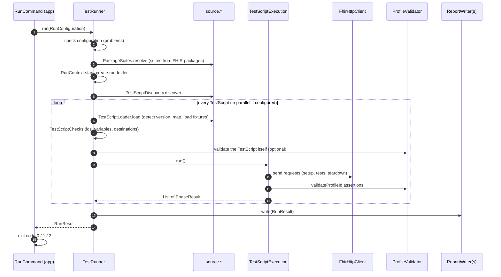
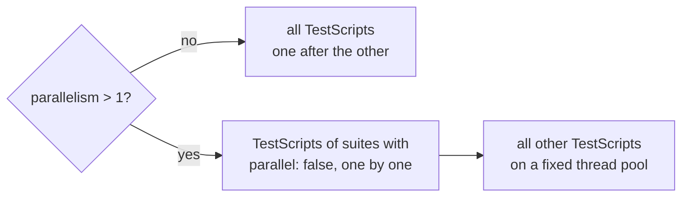
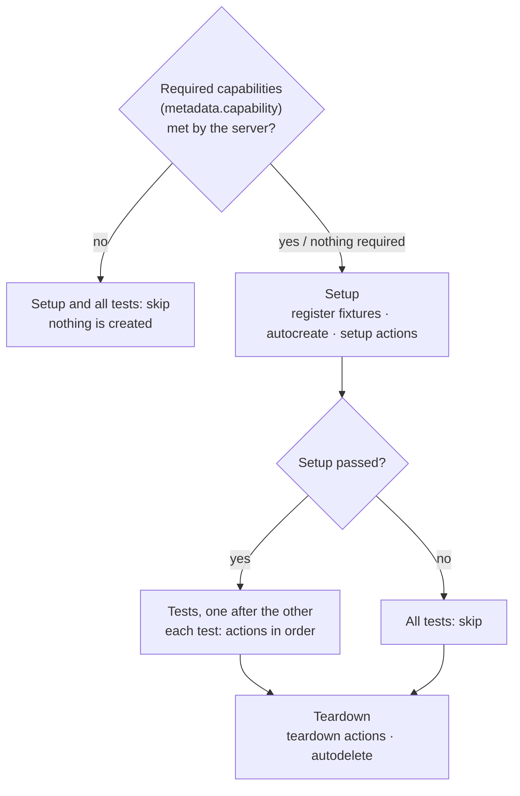
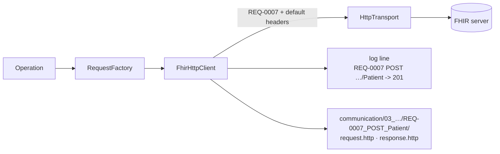
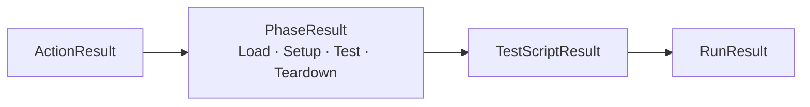

# How a run works

[Home](README.md) › How a run works

This page follows one run from the command line to the reports. Class names link the steps to the code.

## Overview

## 1. Start and configuration check

`RunCommand` (in `testrunner-app`) calls `TestRunner.run(configuration)`.

`TestRunner` first collects **all** problems at once:

* `RunConfiguration.problems()` – missing suites, missing folders, invalid levels, no validator jar.
* `unsupportedVersions()` – a suite pins a FHIR version that no module on the classpath supports.
* `unknownFormats()` – a report format that no `ReportWriter` provides.

Then suites with a `package-id` are resolved by `PackageSuites`. It finds the package in the FHIR package cache,
or downloads it. The suite then points to the unpacked folder.

Any problem stops the run before anything is sent: `ConfigurationException`, exit code **2**.

## 2. Run context

`RunContext.start` creates what the run shares:

| Field | Example |
|---|---|
| `runId` | `run_2026-10-26_10-00-00-000` |
| `runDirectory` | `testrunner-results/run_2026-10-26_10-00-00-000/` |
| `requestCounter` | an `AtomicInteger` → request ids `REQ-0001`, `REQ-0002`, … |

`RunListener.runStarted` is called. The `RunLogFileListener` attaches the `testrunner.log` file appender now.

## 3. Discovery

`TestScriptDiscovery` lists the files of every suite. It applies the `include` globs to the
`Test_Scripts` folder. The order is stable: suite order, then file path. Each file becomes a
`TestScriptSource` with a number, e.g. `03_TestScript-testscript-patient-update-at-core`.

## 4. Scheduling

`TestRunner.runAll` decides the order ([ADR-0008](../adr/0008-parallel-execution.md)):

Results keep their discovery number. Reports are always in discovery order, whatever finishes first.

## 5. Loading one TestScript

`TestScriptLoader.load` does three things:

1. **Detect the FHIR version.** A pinned `fhir-version` wins. With `AUTO`, every version module parses the file
   strictly. The version without errors and with the fewest warnings wins. See
   [fhir-versions.md](../fhir-versions.md#version-detection).
2. **Map.** The chosen `FhirVersionSupport` maps the file to the neutral `TestScript` record. Content the version
   ignores becomes a *read warning*.
3. **Load the resources.** Fixture resources come from `Example_Instances/` (`ExampleInstanceResolver`). Required
   CapabilityStatements are looked up there too, then next to the TestScripts.

If loading fails, the TestScript gets an `error` in the phase `Load`. Nothing is sent. The other TestScripts run.

## 6. Checks before sending

* `TestScriptChecks` – unique fixture/response/request ids, well-formed variables, at most one destination.
* Validation of the TestScript itself against its FHIR version, if `validate-test-scripts` is on.
* No FHIR server configured → every test is `skip`.

## 7. Execution

`TestScriptExecution` runs the phases. It owns an `ExecutionState` and the helpers that work on it.

Inside a phase, actions run in order:

| Action | What happens |
|---|---|
| Operation | `${…}` placeholders resolved → `RequestFactory` builds the request → `FhirHttpClient` sends it → response stored in `ExecutionState` |
| Assertion | placeholders resolved → `AssertionEvaluator` checks the last response, or the fixture/response named by `sourceId` |

How outcomes affect the phase:

| Situation | Recorded | Phase |
|---|---|---|
| Assertion fails | `fail` | goes on |
| … with `stopTestOnFail` | `fail` | stops |
| … with `warningOnly` | `pass` with warning | goes on |
| Action cannot be executed | `error` | stops |

The full table is in [architecture.md](../architecture.md#execution-semantics).

### The helpers

| Class | Job |
|---|---|
| `ExecutionState` | fixtures, responses kept by `responseId`, the last response |
| `VariableResolver` | replaces `${name}` with the variable's current value, evaluated each time it is used |
| `RequestFactory` | builds URL, headers and body of an operation |
| `AssertionEvaluator` | evaluates one assertion (one `Check` type each) |
| `FixtureManager` | registers fixtures; autocreate in dependency order; autodelete in reverse order |
| `CapabilityCheck` | compares the required CapabilityStatement with the server's (`GET [base]/metadata`, once per server and run) |

## 8. Every request goes through `FhirHttpClient`

The request id appears in the log, in the assertion messages, in the reports and in the folder name. From a failed
assertion you can find the exact bytes. See [logging.md](../logging.md#request-ids-tie-everything-together).

## 9. Results and reports

Results are immutable records, built bottom-up:

Outcomes combine by severity: `error > fail > skip > pass`.

`TestRunner` hands the `RunResult` to each configured `ReportWriter`. Then `RunListener.runFinished` is called and
the log file is closed.

| Format | File | Writer |
|---|---|---|
| `junit` | `junit.xml` | `JUnitXmlReportWriter` |
| `summary` | `summary.txt` | `SummaryReportWriter` |
| `json` | `result.json` | `JsonReportWriter` |
| `testreport` | `testreports/TestReport-NN_….json` | `TestReportWriter` + the version module's encoder |

## 10. Exit code

| Code | Meaning |
|---|---|
| 0 | every TestScript passed or was skipped |
| 1 | at least one `fail` or `error` |
| 2 | invalid configuration, nothing was run |

Next: [Design insights](design-insights.md).
