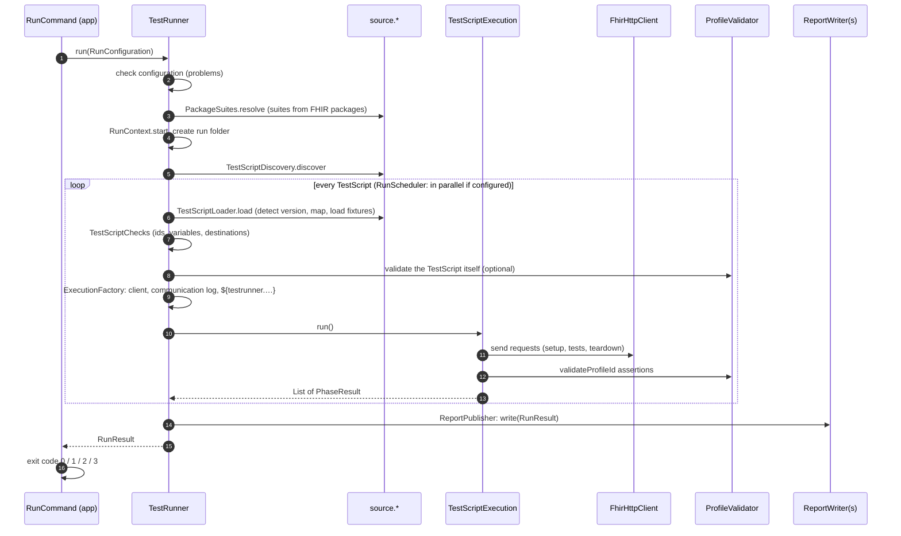
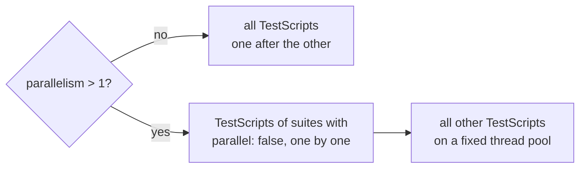
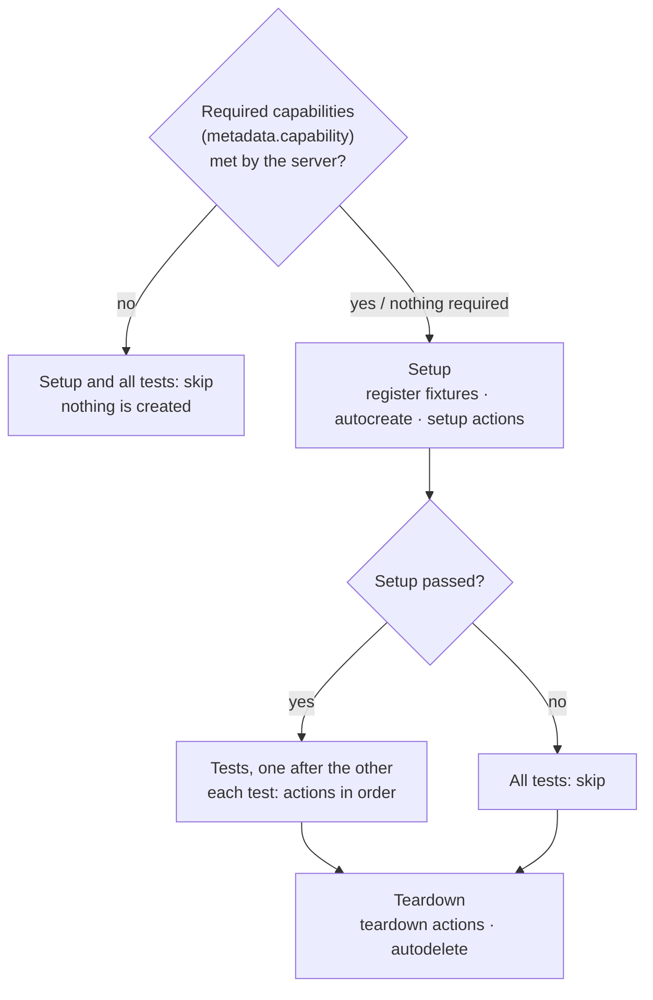
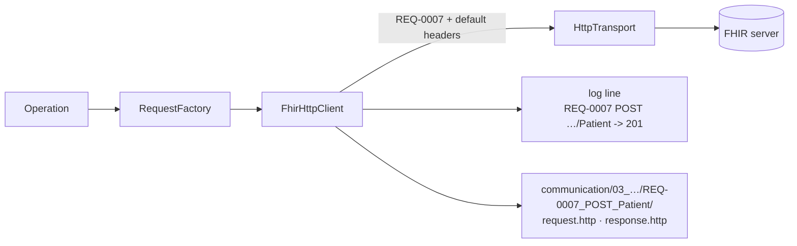
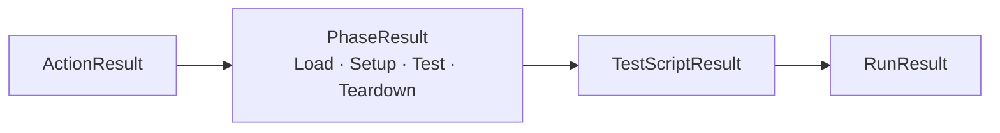

# How a run works

[Home](README.md) › How a run works

This page follows one run from the command line to the reports. Class names link the steps to the code.

## Overview



## 1. Start and configuration check

`RunCommand` (in `testrunner-app`) calls `TestRunner.run(configuration)`, or `TestRunner.check(configuration)` with
`--check`. A check goes the same way up to the end of step 6 and then stops: see
[Check mode](#check-mode-stop-before-sending).

`TestRunner` first collects **all** problems at once:

* `RunConfiguration.problems()` – missing suites, missing folders, invalid levels.
* `unsupportedVersions()` – a suite pins a FHIR version that no module on the classpath supports.
* `unknownFormats()` – a report format that no `ReportWriter` provides.
* `ProfileValidator.configurationProblems()` – the validator's own settings, e.g. no validator jar. The adapter
  knows its properties; with validation off, the validator is `DISABLED` and reports none. A check asks only if it
  validates the TestScripts.

Then suites with a `package-id` are resolved by `PackageSuites`. It finds the package in the FHIR package cache,
or downloads it. The suite then points to the unpacked folder.

Any problem stops the run before anything is sent: `ConfigurationException`, exit code **2**.

## 2. Run context

`RunContext.start` creates what the run shares:

| Field | Example |
|---|---|
| `runId` | `run_2026-10-26_10-00-00-000` |
| `runDirectory` | `testrunner-results/run_2026-10-26_10-00-00-000/` |
| `requestCounter` | an `AtomicInteger` → request ids `REQ-0001`, `REQ-0002`, … |

`RunListener.runStarted` is called with a `RunInfo`: the run id, start, configuration and run folder, without the
counter and the tokens. The `RunLogFileListener` attaches the `testrunner.log` file appender now.

## 3. Discovery

`TestScriptDiscovery` lists the files of every suite. It applies the `include` globs to the
`Test_Scripts` folder. The order is stable: suite order, then file path. Each file becomes a
`TestScriptSource` with a number, e.g. `03_TestScript-testscript-patient-update-at-core`.

## 4. Scheduling

`RunScheduler` decides the order ([ADR-0008](../adr/0008-parallel-execution.md)):



Results keep their discovery number. Reports are always in discovery order, whatever finishes first.

Before a TestScript starts, `RunScheduler` asks the run's `RunControl` whether it may. It may not once the run
`timeout` has passed, the run was cancelled (`RunControl.cancel`), or `fail-fast` is on and a TestScript ended with
`fail` or `error`. Such a TestScript is `skip`: "Not started: …" in the phase `Load`. See
[configuration.md › Run control](../configuration.md#run-control).

## 5. Loading one TestScript

`TestScriptLoader.load` does three things:

1. **Detect the FHIR version.** A pinned `fhir-version` wins. With `AUTO`, every version module parses the file
   strictly. The version without errors and with the fewest warnings wins. See
   [fhir-versions.md](../fhir-versions.md#version-detection).
2. **Map.** The chosen `FhirVersionSupport` maps the file to the neutral `TestScript` record. Content the version
   ignores becomes a *read warning*.
3. **Load the resources.** Fixture resources come from `TestScript.contained` (reference `#id`) or from
   `Example_Instances/` (`ExampleInstanceResolver`), see [Fixtures](fixtures.md). Required
   CapabilityStatements are looked up there too, then next to the TestScripts.

If loading fails, the TestScript gets an `error` in the phase `Load`. Nothing is sent. The other TestScripts run.

## 6. Checks before sending

* `TestScriptChecks` – unique fixture/response/request ids, well-formed variables, at most one destination.
  It also walks the actions in the order they run, applies the `ActionRules` to each and checks every reference. See
  below.
* Validation of the TestScript itself against its FHIR version, if `validate-test-scripts` is on.
* No FHIR server configured → every test is `skip`.

Each problem gives an `error` in the phase `Load`. All problems are listed at once, and nothing is sent. So a typo
never leaves a half-created fixture on the server.

What the reference check finds:

| Problem | Example message |
|---|---|
| an id that names nothing | `Test 'read', action 2: targetId 'creatd' is neither a fixture nor the responseId or requestId of an operation` |
| a response used before the operation that keeps it | `Setup, action 1: targetId 'later' is not there yet, it is kept by Test 't', action 1` |
| `targetId` on a fixture that is not created | `targetId 'p' is a fixture without autocreate, so it has no id on the server` |
| `targetId` on a kept request | `targetId 'sent' is a requestId; use the responseId of that operation …` |
| a `${name}` that is no variable | `Variable 'pid' (Test 'read', action 1) is used but not defined by the TestScript` |
| an unknown `${testrunner.…}` value | `'${testrunner.nope}' (…) is no value of the runner; known: […]` |
| a variable on a response in an autocreated fixture | `Fixture 'obs' (autocreate): variable 'pid' reads 'created', which is not there yet …` |
| a variable or assertion on the last response, before any operation | `Test 't', action 1: the assertion has no sourceId and no operation runs before it …` |
| `headerField` on a fixture | `variable 'etag' reads header ETag, but 'p' is a fixture, not a response` |
| an undeclared profile | `validateProfileId 'q' is not declared in TestScript.profile (declared: [p])` |

What the action rules (`ActionRules`) find:

| Problem | Example message |
|---|---|
| an operator the check does not allow | `Test 't', action 2: Operator greaterThan cannot be used with contentType (allowed: contains, notContains, equals, notEquals)` |
| an operator that needs a value, without `value` or `compareToSourceId` | `Operator equals needs a value or compareToSourceId` |
| an element the operation type forbids | `create must not have a targetId`, `transaction must not have params` |
| no method | `The HTTP method cannot be determined: the operation has no method and the unknown type 'custom'` |
| nothing to send | `The PUT of operation 'update' has no sourceId, so there is nothing to send` |
| no URL | `The URL cannot be determined for operation 'read': it has no resource, params, url or targetId` |

The same rules are applied again when an action runs. With values only known then (`resource: ${type}`) an action
can still fail at run time, e.g. on an invalid URL.

Assertions the runner cannot evaluate get a **warning**, not an error:

| Assertion | Warning on the Setup |
|---|---|
| `requestMethod`, `requestURL` | `Test 'client', action 2: requestURL is not supported – it checks a request received by the system under test, and the runner sends every request itself; the assertion will be an error when it runs` |
| operator `manualEval` | `Test 'human', action 2: Operator manualEval is not supported – it needs a human tester; …` |

They stay an `error` when they run, as the outcome rules say. The warning only makes them visible before the setup
changes data on the server. The rest of the TestScript still runs. If the TestScript also has problems, the
warnings are listed after them in the `Load` phase.

Only what fails in **every** run is reported. A response kept in an earlier test counts as there, even if that test
might stop early. An id or profile that is itself a placeholder (`sourceId: ${which}`) is checked when it is used.

### Check mode: stop before sending

`TestRunner.check` (`--check`) runs steps 1 to 6 and stops before the first request
([ADR-0014](../adr/0014-author-workflow.md)):

| | Run | Check |
|---|---|---|
| Run folder | `run_<timestamp>` | `check_<timestamp>` |
| FHIR server | needed, else `skip` | not needed |
| Phases of a TestScript | `Load` (only if it has problems), Setup, tests, Teardown | `Load` only: `pass` with the warnings, or `error` |
| Warnings (ignored elements, unsupported assertions, fixture order) | on the Setup | on `Load` |
| Reports | all configured formats | all but `testreport` |
| `fail-fast`, `test-script-timeout` | apply | do not apply; the run timeout does |

## 7. Execution

`TestScriptExecution` runs the phases. It owns an `ExecutionState` and the helpers that work on it.



Inside a phase, actions run in order:

| Action | What happens |
|---|---|
| Operation | `${…}` placeholders resolved → `RequestFactory` builds the request → `FhirHttpClient` sends it → request and response stored in `ExecutionState` |
| Assertion | placeholders resolved → `AssertionEvaluator` checks the last response, the last request (`direction: request`), or the fixture, response or request named by `sourceId` |

How outcomes affect the phase:

| Situation | Recorded | Phase |
|---|---|---|
| Assertion fails | `fail` | goes on |
| … with `stopTestOnFail` | `fail` | stops |
| … with `warningOnly` | `pass` with warning | goes on |
| Action cannot be executed | `error` | stops |
| A limit has passed (run or TestScript timeout, run cancelled) – checked before each action | `error` "Stopped before the next action: …" | stops; later tests `skip`; teardown still runs |

The full table is in [architecture.md](../architecture.md#execution-semantics).

### Reading the runner's own requests

Every operation leaves two things behind: the response and the request as it was sent. An operation can keep both
under ids of its own:

* `responseId` keeps the response.
* `requestId` keeps the request: URL, headers and body, with every placeholder replaced.

Both work as `sourceId` of an assertion or a variable. An assertion with `direction: request` and no `sourceId`
checks the last request instead of the last response.

This helps when the runner generates a value. Here the fixture gets a random identifier, and the test searches for
exactly that value:

```json
"variable": [{ "name": "sent", "expression": "Patient.identifier[0].value", "sourceId": "create-request" }],
…
{ "operation": { "type": { "code": "create" }, "resource": "Patient", "sourceId": "patient",
                 "requestId": "create-request" } },
{ "operation": { "type": { "code": "search" }, "resource": "Patient", "params": "?identifier=${sent}" } },
{ "assert": { "direction": "request", "headerField": "Content-Type", "operator": "contains", "value": "json" } }
```

The fixture contains `"value": "${testrunner.uuid}"`. The variable reads the request, so it sees the UUID that was
actually sent.

Limits:

* A request has no status. `response`, `responseCode` and `navigationLinks` need a response; on a request they are
  an `error`.
* `targetId` cannot name a request. Use the `responseId` of the same operation to address what it created.
* `requestMethod` and `requestURL` stay unsupported. They check the requests of a client under test, and the runner
  is that client itself. They are announced as a warning before anything is sent, see
  [Checks before sending](#6-checks-before-sending).

### The helpers

| Class | Job |
|---|---|
| `ExecutionState` | fixtures (as written), responses kept by `responseId`, requests kept by `requestId`, the last response and request |
| `VariableResolver` | replaces `${name}` with the variable's current value, evaluated each time it is used – see [Variables and placeholders](variables.md) |
| `ActionRules` | what an operation or assertion needs whatever its values are: allowed operators, the elements an operation can be built from; used by the three helpers around it |
| `RequestFactory` | builds URL, headers and body of an operation |
| `AssertionEvaluator` | evaluates one assertion (one `Check` type each) |
| `FixtureManager` | registers fixtures; autocreate in dependency order; resolves a fixture at each use; autodelete in reverse order – see [Fixtures](fixtures.md) |
| `CapabilityCheck` | compares the required CapabilityStatement with the server's (`GET [base]/metadata`, once per server and run) |

## 8. Every request goes through `FhirHttpClient`



The request id appears in the log, in the assertion messages, in the reports and in the folder name. From a failed
assertion you can find the exact bytes. See [logging.md](../logging.md#request-ids-tie-everything-together).

## 9. Results and reports

Results are immutable records, built bottom-up:



Outcomes combine by severity: `error > fail > skip > pass`.

`ReportPublisher` hands the `RunResult` to each configured `ReportWriter` and logs the summary. A writer that fails
is logged; the other reports are still written. Then `RunListener.runFinished` is called and the log file is closed.

This happens exactly once for every run that has started, **whatever ends it**:

| The run … | Reports | TestScripts without a result |
|---|---|---|
| ends normally, or is stopped by a limit | at the end | – (stopped ones have their `error`, not started ones their `skip`) |
| throws an unexpected exception or error | written, then the exception is rethrown | started: `error` "Did not end: the run failed: …"; not started: `skip` |
| gets Ctrl-C or SIGTERM (app) | after the teardowns, at most `shutdown-grace` later | as above, "the run was aborted before it ended" |

A listener that throws is logged and does not stop the run. See [ADR-0013](../adr/0013-run-control.md).

| Format | File | Writer |
|---|---|---|
| `junit` | `junit.xml` | `JUnitXmlReportWriter` |
| `summary` | `summary.txt` | `SummaryReportWriter` |
| `json` | `result.json` | `JsonReportWriter` |
| `testreport` | `testreports/TestReport-NN_….json` | `TestReportWriter` + the version module's encoder |

## 10. Exit code

| Code | Meaning |
|---|---|
| 0 | every TestScript passed or was skipped, and at least one passed |
| 1 | at least one `fail` or `error`; in a check: a TestScript has problems |
| 2 | invalid configuration, nothing was run |
| 3 | every TestScript was skipped, nothing was tested |

`testrunner.exit-on-skip` changes when skips give `3`, see [Troubleshooting › Exit codes](troubleshooting.md#exit-codes).

Next: [Design insights](design-insights.md).
