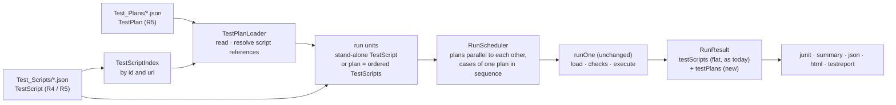
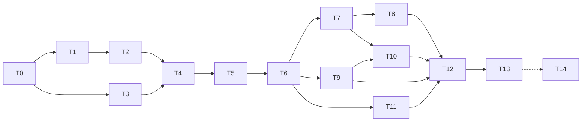

# Plan: FHIR TestPlan support

[Home](README.md) › TestPlan plan

**Status: plan, nothing implemented** (written 2026-11-18, commit `c39e481`). Pick it up with the tasks
[T0–T14](#tasks); the [open decisions](#open-decisions) come first. The design decisions are drafted as
[ADR-0022 to ADR-0026](#adrs) with status *proposed*. When a task is done, move what it decided into the ADR, flip the
ADR to *accepted* and shrink this page. (ADR-0021 is reserved by the [release plan](release-plan.md).)

## Goal

Run FHIR `TestPlan` resources, not only `TestScript`s:

1. A TestPlan names *what* to test and in which order; the TestScripts it points to say *how*. The runner executes the
   TestScripts of a plan, in the order of the plan, and reports per plan, per test case and per TestScript.
2. `TestPlan` exists from **FHIR R5** on. R4 has none. The version handling must say so clearly, and the TestPlan
   feature must not be a second, R5-only copy of the engine.
3. Plans and stand-alone TestScripts live side by side in one run. Nothing that works today changes for a suite without
   plans.
4. All reports are adapted: they show the plan and its cases next to the TestScripts, and consumers that only know
   TestScripts keep working.

**Non-goals** (each is an explicit decision, so that nothing is silently ignored later): evaluating `exitCriteria`
(narrative), running manual tests, running other languages than `testscript` (gherkin, postman), producing test data
from `testData`, state shared between the TestScripts of a plan, fetching a TestScript over the network, TestPlans for
FHIR R6 (see [finding 3](#3-r6-is-a-moving-target-and-a-different-model)).

## Findings (what exists, 2026-11-18)

### 1. The R5 TestPlan

Source: the R5 StructureDefinition (`https://hl7.org/fhir/R5/testplan.profile.json`), **maturity level 0, Draft**. Only
the parts a runner can use are listed.

| Element | Card. | Type | Use for the runner |
|---|---|---|---|
| `url`, `version`, `name`, `title`, `status`, `description`, `identifier` | | | names and identifies the plan in reports; `status` is not checked |
| `scope` | 0..* | Reference | what is tested; shown, not used |
| `dependency.predecessor` | 0..1 | Reference | "test plans that are expected to be successfully performed" first, see [T11](#tasks) |
| `exitCriteria` | 0..1 | markdown | narrative; shown, **not** evaluated |
| `testCase` | 0..* | | the cases of the plan |
| `testCase.sequence` | 0..1 | integer | order of the case in the plan |
| `testCase.scope`, `testCase.dependency.{description,predecessor}` | | | shown; predecessor as above |
| `testCase.testRun` | 0..* | | "the actual test to be executed" |
| `testCase.testRun.narrative` | 0..1 | markdown | manual test; no script |
| `testCase.testRun.script.language` | 0..1 | CodeableConcept | `testscript`, `gherkin`, … |
| `testCase.testRun.script.source[x]` | 0..1 | **string \| Reference** | "references to TestScripts or externally defined content" |
| `testCase.testData`, `testCase.assertion` | 0..* | | descriptions of data and expectations; shown, not executed |

* `TestPlan` is a canonical resource and a `Definition`; it has no `TestReport` counterpart. **`TestReport` has no
  element that points at a TestPlan** in R5 or in any R6 build looked at (`TestReport.testScript` only). Results for a
  plan therefore need an extension or a result format of our own ([ADR-0025](../adr/0025-testplan-results-and-reports.md)).
* The R5 specification has **no usable example**: `testplan-example.json` holds an `id`, a generated narrative and
  `"status": "draft"`, nothing else. The AT Core R5 package (`xx-fhir-testing` branch) has no TestPlan either. Samples have to be written
  ([T12](#tasks)).

### 2. R4 and HAPI (verified with HAPI FHIR 8.12.1 on the runner's class path)

| Probe | Result |
|---|---|
| `FhirContext.forR4().getResourceTypes().contains("TestPlan")` | `false`; parsing a TestPlan throws `HAPI-1684 Unknown resource name "TestPlan" (… not known in FHIR version "R4")` |
| `FhirContext.forR5()` | `true`; a TestPlan with `testCase.testRun.script.sourceReference` / `sourceString` parses |
| An R6-shaped plan (`testCase.key`, `scope.artifactCanonical`) in the R5 parser | parses, two *unknown element* warnings (`CollectingErrorHandler` would report them as warnings, as for TestScripts) |
| `ElementView.children("source[x]")` on the choice | one view per value; `typeName()` is `Reference` (then `string("reference")` is the reference) or `string` (then `primitiveValue()` is the text) |
| `ElementView.children("sourceReference")` when the value is a *string* | **a view as well** (type `Reference`, `primitiveValue()` = the string; `string("reference")` throws `IllegalArgumentException`) |

The last row is a pitfall for the mapper: read the choice through `source[x]` and branch on `typeName()`, never ask for
`sourceReference` and test for emptiness.

Because HAPI itself knows whether a version has a TestPlan, **no per-version flag is needed**: R4 and R5 modules differ
by what their `FhirContext` knows. `org.hl7.fhir.r5:6.9.12` carries `TestPlan` and its seven backbone classes.

### 3. R6 is a moving target and a different model

| Build | TestPlan |
|---|---|
| R5 5.0.0 | as above |
| R6 `6.0.0-ballot3` (2025-04) | still a core resource, but changed: `scope` is a backbone with `artifact[x]` (canonical \| markdown \| uri); `testCase.key` (1..1 `id`), `testCase.requirement`, `testCase.dependency.reference` (canonical) + `key`, `testCase.testCase` (nested), `script.source[x]` also `Attachment` |
| R6 `6.0.0-ballot5` / `6.0.0-snapshot1` (2026-07) | **removed from the core**: the resource list has "+ see also Testing Resources" (the *FHIR Testing IG*, `hl7.fhir.uv.testing`) and no TestPlan page |
| FHIR Testing IG `0.1.0-snapshot1` (CI build, 2026-10, on `6.0.0-snapshot1`) | **a different resource**: `runner` (1..1 url), `mode`, `parameter`, `suite[]` → `test[]` (`operation`, `input`, `expected`, `assertion`), nested `suite`/`plan`. No `testCase`, no TestScript reference; "tests to be executed by a Test Runner that knows the tests". Script languages in the IG's code system: `gherkin`, `postman`, `testscript` |

Consequence: the R5 shape cannot be extended to R6 with a dialect method ([ADR-0005](../adr/0005-fhir-version-mapping.md)),
the R6 plan is structurally another model, and its home is not even settled. TestPlan support is R5 now; R6 is a
decision for when the Testing IG is published ([ADR-0026](../adr/0026-testplan-and-fhir-versions.md), [T14](#tasks)).
The neutral model is kept small so that a later R6 mapper can fill the same records where the ideas overlap.

### 4. The runner today

| Topic | State (checked in the code, and by running `--check` on a suite with a TestPlan file) |
|---|---|
| A TestPlan in `Test_Scripts/` | `include` is `*.json`, `*.xml`, so it is picked up and fails the Load phase: `Not a valid FHIR R5 TestScript: the content is a TestPlan, not a TestScript`. Exit code 1; the other TestScripts are unaffected |
| Unit of work | **everything is a TestScript**: `TestScriptSource(suite, file)` → `TestScriptResult` (index, phases) → `RunResult.testScripts`. The index (`NN_<file>`) is the MDC key, the communication folder, the TestReport name, the JUnit suite. `RunScheduler` schedules a flat list. `RunProgress` and the reports-always rule (ADR-0013) count TestScripts |
| Orchestration | `TestRunner.start` → discovery → `Selection` → `RunScheduler.runAll` → `runOne` (load, checks, execute) → `ReportPublisher`. `check` and `list` share it ([ADR-0014](../adr/0014-author-workflow.md)) |
| Version handling | `FhirVersionSupport` (`check`, `readTestScript`, `fhirPath`, `testReport`), `FhirVersionRegistry.detect` per file; `HapiFhirVersionSupport` is generic; R4/R5 modules are one line each ([ADR-0005](../adr/0005-fhir-version-mapping.md)) |
| Reports | `RunResult` → `TestScriptResult` → `PhaseResult` → `ActionResult`; writers `junit`, `summary`, `json`, `testreport`, `html` read only that. No writer knows a grouping above the TestScript |
| Public API | `report` and `model` are core API (`ArchitectureTest.CORE_API_PACKAGES`); every public position has `@Nonnull`/`@Nullable` (ADR-0017). Constructors are positional: `RunResult` is built in 2 main and 3 test files, `TestScriptResult` in 1 main and 3 test files, `SuiteConfig` in 1 main and 4 test files, `SelectConfig` in 1 main and 3 test files |
| Sample data | none for TestPlans; `testdata/r5/Test_Scripts` holds the AT Core R5 TestScripts a plan can reference |

## The design in one page

1. **A plan expands into TestScript executions.** The engine's unit of execution stays the TestScript. A plan adds
   ordering, grouping and a result node of its own; it does not get a second engine
   ([ADR-0024](../adr/0024-testplan-execution.md)).
2. **A thin, version-neutral model** (`TestPlan`, `TestCase`, `TestRun`, `ScriptRef`) in `core.model`, read by one
   generic mapper in `fhir-hapi` through `ElementView` ([ADR-0022](../adr/0022-testplan-model-and-scope.md)).
3. **TestPlans are discovered in a folder of their own**, `Test_Plans/` (`suites[n].test-plans-dir`); a TestScript that
   a plan references runs in the plan's context only once; unreferenced TestScripts still run stand-alone
   ([ADR-0023](../adr/0023-testplan-discovery-and-selection.md)).
4. **Results get a plan node next to the flat list.** `RunResult.testScripts` keeps meaning what it means today, so
   every existing consumer works; `RunResult.testPlans` adds plans and cases that point at TestScripts by index
   ([ADR-0025](../adr/0025-testplan-results-and-reports.md)).
5. **TestPlan is R5+.** An R4 suite with plans is a configuration problem naming the reason; no TestPlan reading code
   exists in the R4 module because HAPI's R4 does not know the resource
   ([ADR-0026](../adr/0026-testplan-and-fhir-versions.md)).

### What a plan can and cannot say, and how the runner reports each case

| In the plan | Runner | Reported as |
|---|---|---|
| `testRun.script`, language `testscript` (or none) and `source` resolves to a TestScript of the suite | runs the TestScript | the TestScript's own outcome |
| … `source` resolves to nothing, to two, or to something that is no TestScript | nothing is sent for the plan | case `error`, phase `Load` of the plan, naming case, run and source |
| `testRun.script` with another language (`gherkin`, `postman`, …) | not run | case `skip`, "language 'gherkin' is not supported by this runner" + warning on the plan |
| `testRun.narrative` only (manual test) | not run | case `skip`, "manual test: narrative only" |
| `testRun.script.source[x]` is a URL outside the suite | **never fetched** | case `error`, "not part of the suite" |
| `exitCriteria`, `scope`, `testData`, `assertion` | carried into the reports as text | nothing evaluated; warning "testData is not used" when present |
| `testCase.sequence` | cases run in this order; equal or missing values keep declaration order | duplicates ⇒ warning |
| `dependency.predecessor` | phase 1: warning "dependencies are not evaluated"; [T11](#tasks): the predecessor runs first, dependents are `skip` if it did not pass | |

Plan outcome = the combination of its cases (`error > fail > skip > pass`, as everywhere), exit codes unchanged. Never a
silent pass: every case that does not run says why.

## Reports

Every writer keeps its output for TestScripts byte-compatible, apart from added properties and fields, and gains the
plan level. `RunResult.testScripts` is unchanged, `RunResult.testPlans` is new; a `TestPlanResult` holds
`TestCaseResult`s which refer to TestScripts by their index ([ADR-0025](../adr/0025-testplan-results-and-reports.md)).

| Output | Today | With plans |
|---|---|---|
| `junit.xml` | one `testsuite` per TestScript, one `testcase` per phase | unchanged; a TestScript run for a plan gets properties `testPlan` (name), `testPlanUrl`, `testCase` (sequence). Cases that run no TestScript (manual, other language, unresolved) become `skipped` / `error` `testcase`s of an extra `testsuite` named after the plan, so a CI view shows them |
| `summary.txt` | counts and reasons per TestScript | the TestScript block as before; only if the run has plans: a "TestPlans: n" count and a block per plan (outcome, each case with sequence, outcome and TestScript) |
| `result.json` | `testScripts[]` with phases and actions | `testScripts[]` as before plus `testPlan`/`testCase` where the script belongs to a plan; new `testPlans[]`: id, name, url, source, FHIR version, outcome, `exitCriteria`, `messages`, `cases[]` (sequence, description, outcome, `testScript` index, narrative flag, messages) |
| `report.html` | overview table, one section per TestScript | a plan section before the TestScripts it runs: header, exit criteria, table of cases linking to the TestScript sections; a column "Plan / case" in the overview; plan text is **escaped** like all text (narrative is markdown from a package we do not control), never rendered as HTML |
| `testreports/` | one `TestReport` per TestScript | unchanged files; each report of a plan's TestScript carries a runner extension with the TestPlan's canonical (or file URI) and the case sequence, since `TestReport` has no such element. **No** FHIR resource for the plan's own result ([ADR-0025](../adr/0025-testplan-results-and-reports.md)) |
| Run log | `===== TestScript 3/9: …` | `===== TestPlan 1/2: …`, `Case 2/5 (sequence 2): TestScript …`, plan result line; MDC key `testScript` unchanged |
| `RunListener` | `runStarted`, `testScriptFinished`, `runFinished` | + `default void testPlanFinished(RunInfo, TestPlanResult)` (no-op default: source-compatible) |
| Check mode | `Load` phase per TestScript | plus plan problems: unresolved sources, languages, duplicate sequences, cycles; still no TestReports |
| `--list` | TestScripts with tests | plans with cases and the TestScripts each case would run |

Compatibility rules: no existing field changes meaning; a run without plans produces files that differ from today's
only by `"testPlans": []` in `result.json`; the empty-run rule of `RunResult.outcome()` (no TestScripts ⇒ `ERROR`)
counts plans too, otherwise a run of only manual plans would be an error.

## Tasks

Size: S ≤ 1 day, M 2–5 days, L > 1 week (as in [next steps](next-steps.md)). Each task is one pull request with tests
and documentation, in the repository's usual order: code, tests, docs, skills.

| Id | Task | Size | Depends on | Done when |
|---|---|---|---|---|
| **T0** | **Decide** [D1–D6](#open-decisions); review ADR-0022 to 0026 and flip them to *accepted* (or change them) | S | – | decisions recorded in the ADRs |
| **T1** | **Neutral model and port.** `core.model`: `TestPlan`, `TestCase`, `TestRun`, `ScriptRef` (sealed: `Reference`, `Text`), annotated per ADR-0017; `core.spi`: `TestPlanRead(plan, warnings)`, and on `FhirVersionSupport` two **default** methods: `supportsTestPlans()` (false), `checkTestPlan(Body)` / `readTestPlan(Body)` (the latter throws `UnsupportedOperationException`, like `testReport`) | S | T0 | model tests; `ArchitectureTest` green; no existing implementation changed |
| **T2** | **R5 mapper.** `fhir.hapi.TestPlanMapper` (by name through `ElementView`; the `source[x]` choice read as in [finding 2](#2-r4-and-hapi-verified-with-hapi-fhir-8121-on-the-runners-class-path)); `HapiFhirVersionSupport` implements the three methods from `context.getResourceTypes().contains("TestPlan")`, strict parsing with `CollectingErrorHandler` as for TestScripts, warnings kept | M | T1 | `R5SupportTest.readsTestPlans` (all of the table above, both encodings, sequence, string and Reference source, narrative-only), unknown elements ⇒ warnings, `R4SupportTest` says "no TestPlan in FHIR R4" |
| **T3** | **Configuration.** `SuiteConfig`: `testPlansDir` (default `Test_Plans`), `testPlanInclude` (default `*.json`, `*.xml`; packages: `TestPlan-*.json`, `TestPlan-*.xml`, see `withPackage`) + `resolvedTestPlansDir()`; `SelectConfig.testPlans`; `RunConfiguration.problems()` (blank pattern, plans in a suite pinned to R4); binding; factories so call sites do not break (`SuiteConfig` has 4 test call sites) | S | T0 | `RunConfigurationTest`, `TestRunnerAutoConfigurationTest.bindsTheExternalizedProperties`; `docs/configuration.md` |
| **T4** | **Discovery and loading.** `source.TestPlanDiscovery` (a missing folder means no plans, unlike `Test_Scripts`), `TestPlanSource`, `TestPlanLoader` (version: pinned, else among the versions that `supportsTestPlans()`; none ⇒ error naming `testrunner-fhir-r5`), run-scoped `TestScriptIndex` (id, url without `\|version`, file name; reads each file once through `TestScriptLoader.map`), `LoadedTestPlan` with the resolved members or the reason each one failed | M | T2, T3 | resolution tests: `TestScript/<id>`, canonical, with and without `\|version`, file name, ambiguous (two TestScripts with one url ⇒ problem), missing, outside the suite (URL ⇒ problem, nothing fetched) |
| **T5** | **Checks before sending.** `engine.TestPlanChecks` in the style of `TestScriptChecks`: unresolved/ambiguous source, unsupported language, narrative-only runs, duplicate `sequence`, dependency cycle (T11), `testData` warning; messages name the place (`TestPlan 'x', case 2 (sequence 2), run 1: …`) | S | T4 | `TestPlanChecksTest`; every case of the [table](#what-a-plan-can-and-cannot-say-and-how-the-runner-reports-each-case) is a test |
| **T6** | **Orchestration.** Run units: a stand-alone TestScript or a plan (ordered members). `RunScheduler` schedules units (plans in parallel with each other, the cases of one plan one after the other, `suites[n].parallel: false` still honoured); the *reference-once* rule; one TestScript index per run; `runOne` is **not** changed, it gets the member's `TestScriptSource`; fail-fast and run timeout inside a plan (rest `skip`, "Not started: …"); log lines and MDC | L | T5 | `TestPlanRunTest` with `Harness`: order by sequence, two plans in parallel, plan unaffected by parallelism, fail-fast, run timeout, a TestScript referenced twice runs twice with two indexes, stand-alone suppression |
| **T7** | **Results.** `report.TestPlanResult`, `TestCaseResult`, `RunResult.testPlans` (+ compatibility constructor), outcome rules incl. the empty-run rule, `RunProgress` knows plans (reports-always: an unfinished plan is `error` "Did not end", an unstarted one `skip` "Not started"), `RunListener.testPlanFinished` | M | T6 | `RunControlTest` extended; `ArchitectureTest.publicApiDeclaresWhereNullIsAllowed` green; CHANGELOG "Changed – API" |
| **T8** | **Report writers.** JUnit, summary, JSON, HTML and TestReport as in the [table](#reports); `ExchangeFolders` unchanged | M | T7 | one test per writer on a plan result: `JUnitXmlReportWriterTest`, `SummaryReportWriterTest`, `JsonReportWriterTest`, `HtmlReportWriterTest` (hostile narrative, links to TestScript sections exist), `TestReportWriterTest`, `R5SupportTest.writesAValidR5TestReport…` parsed back by HAPI with the extension |
| **T9** | **Selection and list.** `select.test-plans` (globs on file name ± extension, `name`, `url`, `id`), `--testplan=<glob>`, `Selection` extended, `TestRunner.list` returns plans with cases (`Listed` gets a plan variant), `RunCommand.list` prints the tree | M | T6 | `SelectionTest`, `RunCommandTest.list…`, `EndToEndIT` (selected plan runs only its TestScripts) |
| **T10** | **Check mode and validation.** `--check` loads and checks plans, same exit codes, no TestReports; with `validation.validate-test-scripts` the plan file is validated against the base spec of its version (setting name stays, documented; D6) | S | T7, T9 | `CheckModeTest` with a broken plan; `RealValidatorIT` validates a plan (skipped without the jar) |
| **T11** | **Plan dependencies (phase 2).** `dependency.predecessor` of plan and case: resolved among the suite's plans (`TestPlan/<id>` or canonical); topological order; a dependent whose predecessor is not `pass` is `skip` "Not started: predecessor 'x' ended with FAIL"; cycle ⇒ `Load` error | M | T6 | tests for order, skip, cycle, predecessor in another suite (problem) |
| **T12** | **Samples and integration tests.** `testdata/r5/Test_Plans/`: a plan over the AT Core R5 TestScripts (two cases in `sequence` out of declaration order), one with a manual case, a `gherkin` case, an unresolved source (negative control for the check); entries in `config/dev-r5.yml` and `dev-all.yml`; `EndToEndIT` (all outputs of a plan run), `HapiServerIT` (the plan against HAPI R5; skipped without Docker); wiki [Samples](samples.md) | M | T8, T9, T10, T11 | green `mvn verify`; `HapiServerIT` shows `Skipped: 0` where Docker is reachable (see the build skill) |
| **T13** | **Documentation and skills.** Accept the ADRs; `docs/architecture.md` (execution-semantics table, open points), `fhir-versions.md` (TestPlan is R5+, R6 note, the recipe), `configuration.md`, `logging.md`, `README`, `CHANGELOG`, wiki pages (run lifecycle, glossary, modules, extending, troubleshooting), this page shrinks; `ArchitectureTest.CORE_API_TYPES` for new `engine` types if other modules need them; skills `testrunner-overview`, `-execution-engine`, `-fhir-versions`, `-logging-and-reports`, `-configuration`, `-testing` | M | T12 | docs and skills agree with the code (the source-of-truth rule of the wiki) |
| **T14** | **R6 (not now).** Revisit when the FHIR Testing IG is published and HAPI has R6 structures: a decision in a new ADR whether the Testing IG's `TestPlan` (runner, suites, tests) is mapped into the same neutral model, or into one of its own | – | T13, F10 | a new ADR |

Critical path: T0 → T1 → T2 → T4 → T5 → T6 → T7 → T8 → T12 → T13. T3, T9, T10 and T11 hang off it. T1 to T5 change no
behaviour (nothing calls them yet), so they can merge early and small.

## Risks

| Risk | Impact | Counter |
|---|---|---|
| The R5 TestPlan is maturity level 0 and R6 replaces it | An investment in a shape that the standard abandons | Keep the model thin, keep R5 reading in one mapper, no engine change for plans ([ADR-0022](../adr/0022-testplan-model-and-scope.md), [ADR-0026](../adr/0026-testplan-and-fhir-versions.md)); T14 is separate |
| Nobody has real TestPlans yet (no spec example, none in AT Core) | The mapping is checked against samples written by us | T12 samples follow the structure definition; the neutral model reads what the specification says, and warns about everything else |
| Public result types change (`RunResult`) | Applications of the library break | add a component and keep the old constructor; `testScripts` keeps its meaning; CHANGELOG "Changed – API" |
| Plan scheduling grows `RunScheduler` and `TestRunner` again (A5 split them) | The class that A5 shrank grows | plan assembly in its own classes (`TestPlanExecutions`, `TestPlanChecks`), `runOne` untouched |
| A package's TestPlan directs the runner somewhere unexpected | Requests to servers or files the user did not choose | a source is resolved only inside the suite; URLs are never fetched; servers come from the configuration only (as ADR-0019 decided for `destination.url`) |
| Markdown from a plan in an HTML report | Script injection | escape everything, as `HtmlReportWriter` already does; a test with hostile narrative (T8) |
| The same TestScript twice in one run changes the numbering users know | Surprise | the index counts executions, as it counts TestScripts today; documented; `--list` shows it |

## Open decisions

Each has a recommendation, which the ADRs assume. T0 settles them.

1. **D1 – Where are TestPlans?** Recommended: a folder of its own, `Test_Plans/`, `suites[n].test-plans-dir`
   ([ADR-0023](../adr/0023-testplan-discovery-and-selection.md)); a TestPlan in `Test_Scripts/` stays an error, with a
   message that names the folder. Alternative: one folder, sorted by `resourceType`. Packages keep all files in one
   folder, so there the include pattern (`TestPlan-*.json`) does the sorting either way.
2. **D2 – Plan and stand-alone run together?** Recommended: a TestScript that a plan of the same suite references runs
   in the plan's context only (*reference-once*); the others run stand-alone, as today; `select.test-plans` without
   `select.test-scripts` runs plans only. Alternatives: plans only as soon as a suite has plans; or both, with doubles.
3. **D3 – Cases that cannot run** (manual, other language): recommended `skip` with the reason, so that the exit code
   rule ("3 only if everything was skipped") stays as it is. Alternatives: `error` (unsupported ⇒ red, as an
   unsupported assertion), or a new outcome (every `switch` over `Outcome` changes).
4. **D4 – Order and parallelism:** recommended: the cases of one plan run one after the other in `sequence` order,
   plans run in parallel with each other. Alternative: all TestScripts of all plans in the pool (faster, but a case
   may depend on an earlier one: ADR-0008 says the order of actions matters, and `testCase.dependency` says so for
   cases).
5. **D5 – Link from a `TestReport` to its plan:** recommended: an extension on each report with a URL that the project
   owns (to be chosen, e.g. under the HL7 Austria canonical base). Alternative: no link, only `TestReport.name` =
   "plan / case: script".
6. **D6 – Name of `validation.validate-test-scripts` for plans:** recommended: it covers plans too (documented, no new
   setting). Alternative: `validate-resources`, with the old name as an alias.

## ADRs

| # | Decision | Status |
|---|---|---|
| [0022](../adr/0022-testplan-model-and-scope.md) | TestPlan: a thin neutral model; the plan says what, the TestScript how; what is executed, shown or refused | proposed |
| [0023](../adr/0023-testplan-discovery-and-selection.md) | TestPlans in a folder of their own, script references resolved inside the suite, reference-once, selection | proposed |
| [0024](../adr/0024-testplan-execution.md) | A plan expands into TestScript executions; plan = unit of scheduling; outcomes of cases that cannot run; dependencies in a second step | proposed |
| [0025](../adr/0025-testplan-results-and-reports.md) | A plan node next to the flat TestScript list; every writer adapted; TestReport per TestScript with an extension | proposed |
| [0026](../adr/0026-testplan-and-fhir-versions.md) | TestPlan only from R5; R4 says so; plan and scripts may differ in version; R6 is a separate decision | proposed |

## What this page is based on

* HL7 FHIR R5 `testplan.profile.json` and `testplan-example.json` (https://hl7.org/fhir/R5/); R6 `6.0.0-ballot3`
  `testplan.profile.json`; the R6 `6.0.0-ballot5` resource list; the FHIR Testing IG CI build (`hl7.fhir.uv.testing
  0.1.0-snapshot1`: `StructureDefinition-TestPlan`, `StructureDefinition-TestReport`, `TestPlan-example`);
  the AT Core R5 package of the `xx-fhir-testing` branch (no TestPlan).
* Probes against HAPI FHIR 8.12.1 (`hapi-fhir-structures-r4`/`-r5`, `org.hl7.fhir.r5:6.9.12`) and against the built
  runner on JDK 25 (`--check` on a suite with a TestPlan file).
* The code at `c39e481`: `TestRunner`, `RunScheduler`, `RunProgress`, `Selection`, `TestScriptLoader`,
  `FhirVersionSupport`, `HapiFhirVersionSupport`, `ElementView`, the five `ReportWriter`s, `SuiteConfig`.
