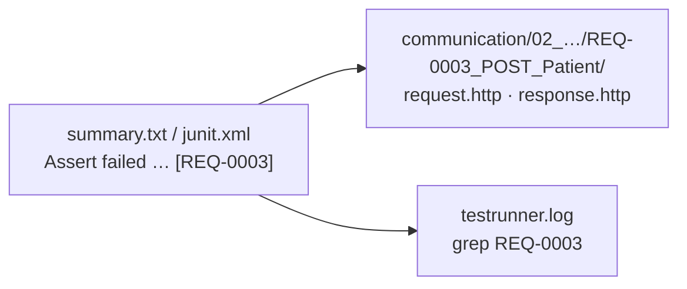

# Troubleshooting

[Home](README.md) › Troubleshooting

## First steps

1. Open `summary.txt` in the run folder. It names every TestScript that did not pass, with the reason.
2. Note the request id in the message, e.g. `[REQ-0003]`.
3. Open `communication/<NN>_<TestScript>/REQ-0003_…/` for the exact request and response.
4. Search `testrunner.log` for the TestScript name or the request id. It has DEBUG details.



In a shell, from the run folder:

```sh
cd target/testrunner-results/$(ls -t target/testrunner-results | head -1)   # the newest run
cat summary.txt
cat communication/*/REQ-0003_*/response.http                               # what the server answered
grep REQ-0003 testrunner.log                                               # what the runner did with it
```

A worked example, from a failed assertion to the bytes: [Samples › Reading a failure](samples.md#reading-a-failure).

A typo in a TestScript does not need a server to show up: `--check` loads and checks every TestScript and sends
nothing ([configuration.md › Check mode](../configuration.md#check-mode)).

## Exit codes

| Code | Meaning | Look at |
|---|---|---|
| 0 | all passed (some may be skipped, see below) | – |
| 1 | at least one `fail` or `error`; with `--check`: a TestScript has problems | `summary.txt` |
| 2 | invalid configuration, nothing ran | the console: all problems are listed |
| 3 | TestScripts were skipped, none failed | `summary.txt` names the reason per TestScript |

By default, `3` means **every** TestScript was skipped – nothing was tested. Typical causes: no FHIR server
configured, or the server lacks a required capability. `testrunner.exit-on-skip` changes this:

| Value | Exit code 3 when … |
|---|---|
| `all` (default) | every TestScript was skipped |
| `any` | at least one TestScript was skipped and none failed |
| `never` | never; skipped counts as passed |

## Common symptoms

| Symptom | Likely cause | Fix |
|---|---|---|
| Every TestScript is `skip`, exit code 3 | no FHIR server configured | set `testrunner.fhir-server.base-url` |
| `error`: "not sent (… No OAuth2 access token from …)" | the token endpoint rejected the client, or `token-url` is wrong | the message has the endpoint's `error`; check `client-id`, `client-secret`, `scope`, `client-authentication` |
| Every request is `401` | no token, or the server wants another `scope` | set `fhir-server.oauth2` or `headers.Authorization`; `Authorization: Bearer ***` in `communication/` shows a token was sent |
| `error` in phase `Load`: version could not be determined | the file is no valid TestScript in R4 or R5 | the message lists the parser errors per version |
| TestScript detected as the wrong version | ambiguous content | pin `fhir-version` on the suite |
| Warning "Ignored while reading the TestScript" | an element that does not exist in the detected version, e.g. `stopTestOnFail` in R4 | fix the TestScript, or pin the version you meant |
| `validateProfileId` passes with a warning "validation is disabled" | `--novalidator` or `validation.enabled=false` | enable validation |
| `validateProfileId` is `error`: validator unavailable | jar missing, wrong Java, or no result written | check `validator-jar`; `ValidatorCheck` warns at start-up |
| Warning "Validating FHIR R4 with one validator process per validation instead" | a validator server failed, fallback is active | look at the server output in `testrunner.log` (`[validator server R4]`); switch with `--testrunner.validation.mode=process` |
| `validateProfileId` is `error` with an unknown profile | the IG does not define the canonical URL the TestScript uses | see [validation.md](../validation.md#where-the-profiles-come-from) |
| The negative control **passes** | validation does not run, or the profile no longer enforces the rule | see [validation.md](../validation.md#the-negative-control) |
| `error` in phase `Load` naming an action, e.g. "Test 'read', action 2: targetId 'x' is neither …" | a typo in an id, variable or profile, or a response used before the operation keeping it | the message names the phase and action; see [How a run works › Checks before sending](run-lifecycle.md#6-checks-before-sending) and the example in [Samples › Mistakes](samples.md#mistakes-found-before-sending) |
| `error` in phase `Load`: "Operator greaterThan cannot be used with contentType (allowed: …)" | the check does not support that operator | use one of the operators listed in the message |
| `error` in phase `Load`: "The PUT of operation 'update' has no sourceId, so there is nothing to send" | an update, create or patch without a body | add the `sourceId` of the fixture to send |
| `error`: "Variable 'x' … has no value" | the source lacks the element or header | see [Variables and placeholders](variables.md#errors) |
| Create fails with `400`/`422`: a reference "cannot be resolved" | a fixture references another fixture by its example id; the server knows it under another id | create the referenced fixture first and set `rewrite-references: all`, or give it `autocreate`; see [Fixtures](fixtures.md#references-to-fixtures-on-the-server) |
| Warning "sends fixture 'x', which references … – but fixture 'y' is only created by …" | the actions create the fixtures in the wrong order | move the create of `y` before the one of `x` |
| A suite passes here but not on another test engine | it relies on runner-specific features: reference rewriting, placeholders in fixtures | run it with `--testrunner.execution.rewrite-references=none` |
| Tests interfere in parallel runs | two TestScripts touch the same server data | use `${testrunner.testScriptId}` or `parallel: false`, see [ADR-0008](../adr/0008-parallel-execution.md) |
| `error` in phase `Load`: "The TestScript addresses 2 servers (destinations [1, 2]) … set testrunner.suites[0].fhir-servers.2.base-url" | a TestScript for several servers, and its suite does not map every destination index | map each index in `suites[n].fhir-servers`, see [configuration.md](../configuration.md#testscripts-for-several-servers) |
| `error` in phase `Load`: "the operation names no destination, but the TestScript addresses several servers" | an operation without `destination` in a TestScript for several servers | add `destination` to the operation |
| Warning on the Setup "… is not supported …; the assertion will be an error when it runs", then `error` for `requestMethod`, `requestURL`, `manualEval` | they need a test engine acting as server, or a human tester | remove them; `warningOnly` does not help, it only softens a `fail` |
| `error` "Stopped before the next action: the TestScript timeout of 2m has passed" | the TestScript took longer than `execution.test-script-timeout` (or the run longer than `execution.timeout`) | the request just before is the slow one: look at its duration in `testrunner.log`; raise the limit or fix the server |
| `error` "Did not end: the run was aborted before it ended" | the runner was stopped (Ctrl-C, CI timeout) and the run did not tear down within `shutdown-grace` | the TestScript may have left data on the server; raise `testrunner.shutdown-grace`, or give the CI job time between SIGTERM and SIGKILL |
| No `junit.xml` after a CI timeout | the CI system sent SIGKILL (`kill -9`) at once, or before `shutdown-grace` was over | let it send SIGTERM first and wait longer than `shutdown-grace`; better: set `execution.timeout` below the job timeout |
| `skip` "Not started: fail-fast: TestScript 02_… ended with FAIL" | `execution.fail-fast` is on and an earlier TestScript failed | fix that one first, or run without `fail-fast` to see every result |
| Capability requirement reported as warning | the required CapabilityStatement is not in Example Instances | add it, or accept that it is not checked |
| No `testrunner.log` | logging backend is not Logback, or `reporting.log-file=false` | the console log and `communication/` still work |
| A `check_<timestamp>` folder without `testreports/` and `communication/` | the run was started with `--check` | intended: a check sends nothing, and a TestReport would claim an execution |
| Fewer TestScripts or tests than expected, nothing `skip` | `testrunner.select` (`--testscript`, `--test`) leaves them out | the log says "Selected 2 of 9 TestScript(s) …; 7 left out"; `--list` shows what runs |
| Exit code 1, "No TestScript is selected" in the log, an empty report | no TestScript matches the selection | check the patterns with `--list`; they match the whole text: `read` does not match `read-patient`, `read*` does |
| `error` in phase `Load`: "… which is kept by Test 'x', action 1, a test that is not selected" | a selected test uses a response or request of a test left out | add that test: `--test=x,y` |
| `zsh: no matches found: --testrunner.suites[0]…` | zsh reads `[0]` as a file pattern | quote the argument: `'--testrunner.suites[0].base-dir=…'` |
| `HapiServerIT`: `Skipped: 3`, log says "Could not find a valid Docker environment" | Docker is not running, or on macOS Testcontainers does not find the socket of Rancher Desktop or Colima | start Docker; on macOS set `DOCKER_HOST` and `TESTCONTAINERS_DOCKER_SOCKET_OVERRIDE`, see [Build and test › Docker on macOS](build-and-test.md#docker-on-macos) |
| `/bin/mvn: no such file` (on the original dev machine) | the shell's `mvn` function needs `M2_HOME` | call Maven by its full path, see skill `testrunner-build-and-run` |

## More detail in the console

```yaml
logging.level.at.hl7.testing.runner: DEBUG                 # everything the run log has
logging.level.at.hl7.testing.runner.communication: DEBUG   # full requests and responses
```

See [logging.md](../logging.md).
