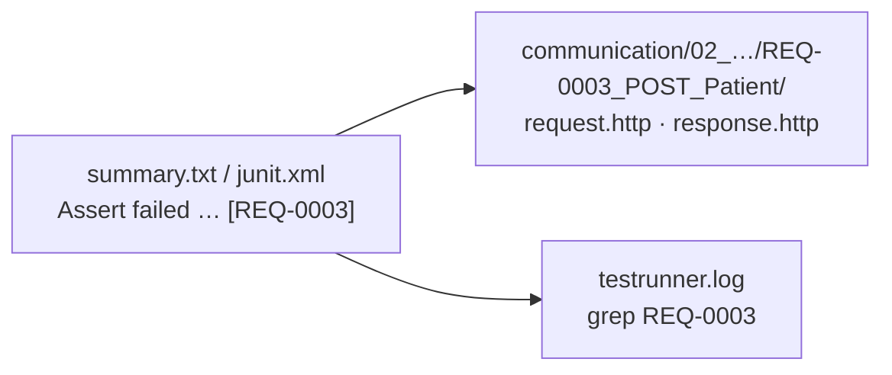

# Troubleshooting

[Home](README.md) › Troubleshooting

## First steps

1. Open `summary.txt` in the run folder. It names every TestScript that did not pass, with the reason.
2. Note the request id in the message, e.g. `[REQ-0003]`.
3. Open `communication/<NN>_<TestScript>/REQ-0003_…/` for the exact request and response.
4. Search `testrunner.log` for the TestScript name or the request id. It has DEBUG details.



## Exit codes

| Code | Meaning | Look at |
|---|---|---|
| 0 | all passed or skipped | – |
| 1 | at least one `fail` or `error` | `summary.txt` |
| 2 | invalid configuration, nothing ran | the console: all problems are listed |

## Common symptoms

| Symptom | Likely cause | Fix |
|---|---|---|
| Every TestScript is `skip` | no FHIR server configured | set `testrunner.fhir-server.base-url` |
| `error` in phase `Load`: version could not be determined | the file is no valid TestScript in R4 or R5 | the message lists the parser errors per version |
| TestScript detected as the wrong version | ambiguous content | pin `fhir-version` on the suite |
| Warning "Ignored while reading the TestScript" | an element that does not exist in the detected version, e.g. `stopTestOnFail` in R4 | fix the TestScript, or pin the version you meant |
| `validateProfileId` passes with a warning "validation is disabled" | `--novalidator` or `validation.enabled=false` | enable validation |
| `validateProfileId` is `error`: validator unavailable | jar missing, wrong Java, or no result written | check `validator-jar`; `ValidatorCheck` warns at start-up |
| Warning "Validating FHIR R4 with one validator process per validation instead" | a validator server failed, fallback is active | look at the server output in `testrunner.log` (`[validator server R4]`); switch with `--testrunner.validation.mode=process` |
| `validateProfileId` is `error` with an unknown profile | the IG does not define the canonical URL the TestScript uses | see [validation.md](../validation.md#where-the-profiles-come-from) |
| The negative control **passes** | validation does not run, or the profile no longer enforces the rule | see [validation.md](../validation.md#the-negative-control) |
| `error`: "Variable 'x' is used but not defined" or "has no value" | a typo, a missing `responseId`, or the source lacks the element | see [Variables and placeholders](variables.md#errors) |
| Tests interfere in parallel runs | two TestScripts touch the same server data | use `${testrunner.testScriptId}` or `parallel: false`, see [ADR-0008](../adr/0008-parallel-execution.md) |
| `error`: the TestScript sends requests to more than one server | several `destination`s | not supported, the runner plays one client against one server |
| `error` for `requestMethod`, `requestURL`, `manualEval` | they need a test engine acting as server, or a human tester | remove them; `warningOnly` does not help, it only softens a `fail` |
| Capability requirement reported as warning | the required CapabilityStatement is not in Example Instances | add it, or accept that it is not checked |
| No `testrunner.log` | logging backend is not Logback, or `reporting.log-file=false` | the console log and `communication/` still work |
| `/bin/mvn: no such file` (on the original dev machine) | the shell's `mvn` function needs `M2_HOME` | call Maven by its full path, see skill `testrunner-build-and-run` |

## More detail in the console

```yaml
logging.level.at.hl7.testing.runner: DEBUG                 # everything the run log has
logging.level.at.hl7.testing.runner.communication: DEBUG   # full requests and responses
```

See [logging.md](../logging.md).
