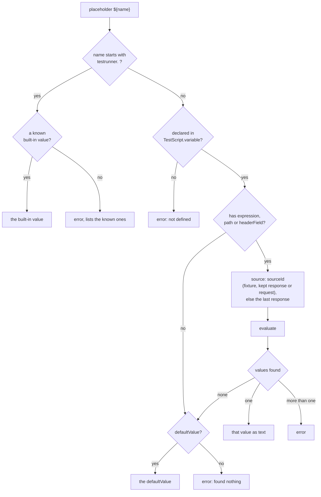

# Variables and placeholders

[Home](README.md) › Variables and placeholders

A TestScript can write `${name}` in many of its values. Just before the runner uses such a value, it replaces each
placeholder. This page explains where that works, where the values come from and when they are computed.

There are two kinds of values:

* **TestScript variables** – declared in `TestScript.variable`, e.g. the id of a resource the server created.
* **Built-in values** – provided by the runner: `${testrunner.runId}`, `${testrunner.uuid}`, …

One class does the work: `VariableResolver` in `core.engine`. Each TestScript execution has its own instance. It
reads the fixtures and responses of that execution from its `ExecutionState`. Nothing is global
([ADR-0004](../adr/0004-no-global-state.md)).

## The rules in short

* A placeholder is `${`, a name, `}`. The name starts with a letter or `_`, then letters, digits, `_`, `.` or `-`.
* Placeholders work in fixture resources and in almost every text value of operations and assertions.
* A variable is evaluated **each time it is used**, against the fixtures and responses at that moment.
* A variable must yield exactly one value. If it finds nothing, its `defaultValue` is used. If there is none: `error`.
* Built-in values are fixed for one TestScript execution.
* A placeholder that cannot be resolved is an `error`, never a `fail`.

## Where placeholders work

| Where | Resolved | Values that may contain `${…}` |
|---|---|---|
| Fixture resources (`Example_Instances/`) | each time the fixture is used; an autocreated fixture once, when it is created | JSON string values; XML attribute values and text |
| Operations | before each operation, just before the request is built | `resource`, `params`, `url`, `accept`, `contentType`, the values of `requestHeader`, `sourceId`, `targetId`, `responseId`, `requestId` |
| Assertions | before each assertion is evaluated | `value`, `sourceId`, `compareToSourceId`, `compareToSourceExpression`, `compareToSourcePath`, and the check itself: `expression`, `path`, `headerField`, `contentType`, `resource`, `responseCode`, `minimumId`, `validateProfileId` |

Not resolved:

* the variable definitions themselves – an `expression` or `defaultValue` containing `${…}` is used as written,
* names in fixture resources (JSON field names, XML element and attribute names), and the field names of
  `requestHeader` (only their values are resolved),
* `type`, `label`, `description`, `method`, `destination`, `operator`, `direction`, the boolean flags, `response`,
  `navigationLinks`.

The request body of an operation is the fixture or response named by `sourceId`. A response is sent as it is. A
fixture has its placeholders replaced at that moment, see [Placeholders in fixture resources](#placeholders-in-fixture-resources).

In the code, `Operation.withValues` and `Assertion.withValues` (in `core.model`) return a copy with every text value
passed through `VariableResolver::resolve`. `TestScriptExecution.execute` and `check` call them. Fixture resources go
through `FixtureManager.resolve` and `ResourceContent.replaceText`. Like the Python PoC, every text value may use
variables, not only `params` and `url`.

## How one text is resolved

`VariableResolver.resolve(text)`:

1. Text without `${` is returned as it is. Most values take this path.
2. Every match of `\$\{([A-Za-z_][A-Za-z0-9_.-]*)}` is replaced, left to right, in one pass.
3. Each name is evaluated once per text. `${id}-${id}` gives the same value twice.
4. An inserted value is not scanned again. A value that contains `${x}` stays as it is. There is no nesting.
5. Text that looks like a placeholder but does not match the pattern (`${ id }`, `${1st}`) is left as it is. This is
   no error – the text reaches the server as written.
6. Every value used is logged at DEBUG: `Variable ${pid} = '123'`.

Each name is looked up like this:



## Where a variable gets its value

A variable has at most one of `expression`, `path` and `headerField`. Without any of them it needs a `defaultValue`.
`TestScriptChecks` enforces both before anything is sent.

| Element | Evaluated with |
|---|---|
| `expression` | FHIRPath of the TestScript's FHIR version (the `FhirPathEvaluator` of `testrunner-fhir-r4` or `-r5`) |
| `path` | JSONPath on a JSON body, XPath on an XML body (`content.PathEvaluator`). The format of the body decides, not the path. |
| `headerField` | the first value of that response header; the name is compared case-insensitively |
| only `defaultValue` | nothing – the value is the default |

The source:

* With `sourceId`: that fixture, the response kept under that `responseId`, or the request kept under that
  `requestId`. It must exist at that moment.
* Without `sourceId`: the last response, i.e. the response of the latest operation so far. Before the first operation
  there is none – an error.
* `headerField` needs a response or a request. A fixture has no headers – an error.

The result (`Values.single`):

| Found | Value |
|---|---|
| one value | as text. Decimals keep their precision (`100.0` stays `100.0`). A JSON object or array becomes JSON text. An XML element with a `value` attribute gives that attribute. |
| nothing (empty result, missing header) | the `defaultValue`; without one, an error |
| more than one | an error: `… returned 2 values where one was expected` |

The `defaultValue` only covers "found nothing". An unknown `sourceId`, a missing last response or an invalid
expression is an error even if a `defaultValue` exists.

## Evaluated at each use

The model records are immutable. `withValues` returns a resolved copy; the operation in the `TestScript` stays a
template. So every use evaluates the variable again, against the state at that moment.

This matters for variables without `sourceId`. Take `loc` with `headerField: Location` and no `sourceId`:

| # | Action | `${loc}` is read from | Request |
|---|---|---|---|
| 1 | create Patient | – | `POST …/Patient` → `Location: …/Patient/1/_history/1` |
| 2 | read, `url: ${loc}` | the response of 1 | `GET …/Patient/1/_history/1` |
| 3 | create Observation | – | `POST …/Observation` → `Location: …/Observation/7/_history/1` |
| 4 | read, `url: ${loc}` | the response of 3 | `GET …/Observation/7/_history/1` |

Give a variable a `sourceId` to tie it to one response. `responseId`s are unique within a TestScript, so such a
variable always reads the same response once it has arrived.

## Built-in values

| Placeholder | Value | Example |
|---|---|---|
| `${testrunner.runId}` | the run id, also the name of the run folder | `run_2026-10-26_10-00-00-000` |
| `${testrunner.testScriptId}` | the run id with every character other than `A-Z a-z 0-9 . -` replaced by `-`, plus the TestScript's two-digit number. A valid FHIR id, unique per TestScript execution. | `run-2026-10-26-10-00-00-000-03` |
| `${testrunner.uuid}` | a random UUID, **one per TestScript execution** – every use in one TestScript gives the same value | `3f1c9a2e-…` |
| `${testrunner.timestamp}` | the start of the TestScript, UTC, to the millisecond | `2026-10-26T10:00:00.123Z` |
| `${testrunner.date}` | the date of that start, UTC | `2026-10-26` |

* `TestRunner.builtInValues` computes them when a TestScript starts. `TestScriptExecution` passes them to its
  `VariableResolver`.
* The prefix `testrunner.` is reserved (`VariableResolver.BUILT_IN`). It is checked first, so a TestScript variable
  with such a name is never used.
* An unknown name such as `${testrunner.nope}` is an error that lists the known ones.
* They exist to give each TestScript execution data of its own. Then TestScripts running in parallel, or again on
  the same server, do not find each other's resources ([ADR-0008](../adr/0008-parallel-execution.md)).

## Placeholders in fixture resources

A fixture is kept as written. Its placeholders are replaced each time it is used: as the body of an operation
(`sourceId`), as `targetId`, as the source of an assertion or a variable, or as `minimumId`. So a fixture can use
a variable on a response that arrived just before.

An autocreated fixture is the exception. It is created when the setup starts, before any operation has run. Its
placeholders are replaced once, at that moment. After that, every use sees the content that was sent.

* Only text values change: JSON string values (also in arrays), XML attribute values and text. Names and structure
  stay. The value is escaped when the document is written, so a value with `"` or `<` cannot break it. A body that is
  neither JSON nor XML is treated as one text.
* A JSON string stays a string. `"valueInteger": "${n}"` sends `"5"`, not `5`.
* In an autocreated fixture, only these resolve: built-in values, variables with only a `defaultValue`, and
  variables on another fixture. A variable on a response fails there – no operation has run yet.
* A variable that reads the fixture it is used in is an `error`: `Fixture 'p': a variable reads the fixture it is
  used in (p -> p)`.
* A failing placeholder is an `error` where the fixture is used. In an autocreated fixture, that is the Setup
  (`Fixture initialization failed: Fixture 'p': …`); the tests are skipped and the teardown runs.
* A body without `${` is neither parsed nor rewritten.

Example (from `TestScriptExecutionTest.FixtureValues`):

```json
{
  "resourceType": "Patient",
  "identifier": [{ "system": "urn:test", "value": "${testrunner.testScriptId}" }],
  "name": [{ "family": "${family}" }]
}
```

With `autocreate` and a search with `params: ?identifier=${testrunner.testScriptId}`, each TestScript finds exactly its
own patient, also with `parallelism: 2`.

A fixture that uses the id of a resource created in a test:

```json
{
  "resourceType": "Observation",
  "status": "final",
  "subject": { "reference": "Patient/${pid}" }
}
```

```json
"variable": [{ "name": "pid", "expression": "Patient.id", "sourceId": "created" }],
…
{ "operation": { "type": { "code": "create" }, "resource": "Patient", "sourceId": "patient", "responseId": "created" } },
{ "operation": { "type": { "code": "create" }, "resource": "Observation", "sourceId": "obs" } }
```

The Patient is created first and gets the id `1`. When the Observation is sent, `${pid}` is evaluated on the
response `created`, and the server gets `"reference": "Patient/1"`.

A variable on an autocreated fixture reads the fixture as it was sent. That content does not contain the id the
server assigned. To address the created resource, use `targetId` – it uses the server's id. References to an
autocreated fixture are rewritten for you, see [Fixtures › References](fixtures.md#references-to-fixtures-on-the-server).
With `rewrite-references: all`, so are references to fixtures created by actions – then the Observation example
above needs no variable.

## Errors

| When | Problem | Outcome |
|---|---|---|
| reading the TestScript | a variable without `name` | `error` in phase `Load` |
| before anything is sent (`TestScriptChecks`) | two variables with the same name; more than one of `expression`, `path`, `headerField`; none of them and no `defaultValue` | `error` in phase `Load`, nothing sent |
| before anything is sent (`TestScriptChecks`) | a `${name}` that is no variable and no `testrunner.*` value; a variable whose `sourceId` names nothing, or a response kept only later; a variable on the last response before any operation; `headerField` on a fixture | `error` in phase `Load`, nothing sent |
| setup start | a placeholder in an autocreated fixture fails | Setup `error`, tests `skip`, teardown runs |
| a fixture is used | a placeholder in that fixture fails | the operation or assertion using it is `error`, the phase stops |
| an operation | a placeholder fails | the operation is `error`, the phase stops |
| an assertion | a placeholder fails | the assertion is `error`, the phase stops. `warningOnly` does not help; it only softens a `fail`. |

`TestScriptChecks` walks the actions in the order they run. It finds a placeholder that can never resolve before
anything is sent, also inside a fixture resource. The message names where the placeholder is used:

```
TestScript is not valid: Variable 'pdi' (Test 'read', action 1) is used but not defined by the TestScript
```

A variable is only checked where it is used. A declared but unused variable with a broken `sourceId` is no error.

What remains for the run is what depends on the server's answers. A placeholder then fails with one of these
messages (`TestScriptException`):

| Message | Cause |
|---|---|
| `Variable 'x' is used but not defined by the TestScript` | a typo, or the variable is missing in `TestScript.variable` |
| `'${testrunner.x}' is no value of the runner; known: […]` | an unknown built-in value |
| `sourceId of variable 'x' 'r' is neither a fixture nor the responseId or requestId of an earlier operation` | the operation that keeps `r` was skipped, e.g. its test stopped early |
| `Variable 'x' has no sourceId and no operation has been executed yet` | used before the first operation, e.g. in an autocreated fixture |
| `Fixture 'p': a variable reads the fixture it is used in (p -> p)` | a fixture uses a variable whose `sourceId` is that fixture |
| `Variable 'x' reads header H, but 'f' is a fixture, not a response` | `headerField` on a fixture |
| `Expression '…' of variable 'x' returned 2 values where one was expected: […]` | the expression or path is not specific enough, e.g. use `.first()` |
| `Variable 'x' has no value: expression '…' on r found nothing and there is no defaultValue` | the source lacks the element or header – check the response in `communication/` |
| `'…' is no valid JSONPath …`, `… no valid XPath …`, a FHIRPath error | an invalid `path` or `expression`, or a body that is neither JSON nor XML |

Why `error` and not `fail`: without the value, the TestScript cannot be executed as written. See
[Design insights › fail versus error](design-insights.md#8-fail-versus-error).

## Seeing the values

* `testrunner.log` (DEBUG by default) has one line per value used: `Variable ${pid} = '123'`.
* Operation descriptions in the log and the reports show the resolved values: `read Patient (GET, params /123)`. If
  resolving fails, the description shows the placeholder as written.
* Assertion descriptions show the placeholders as written: `expression 'Patient.id' equals '${pid}'`.
* `communication/` has every request as sent, with all values replaced.

## A worked example

The sample `testdata/samples/Test_Scripts/TestScript-testscript-patient-update-at-core.json`:

```json
"variable": [{
  "name": "patientResourceId",
  "defaultValue": "1007",
  "hint": "[Resource Id]"
}],
…
"operation": {
  "type": { "code": "update" },
  "resource": "Patient",
  "params": "/${patientResourceId}",
  "sourceId": "patient-update"
}
```

1. The variable has only a `defaultValue`, so its value is `1007`. The `hint` is a prompt for a human tester. The
   runner never prompts; it uses the default.
2. Before the update, `params` becomes `/1007`. `RequestFactory` builds `[base]/[resource][params]` =
   `[base]/Patient/1007`.
3. `encodeRequestUrl` (default `true`) percent-encodes the URL after the replacement.
4. For an update of `[base]/[type]/[id]`, `RequestFactory` sets the id of the body to that id, `1007`. A
   conditional update (`params: "?identifier=…"`) sends the body as it is.
5. The server gets `PUT [base]/Patient/1007`. The log has `Variable ${patientResourceId} = '1007'`.

A variable on a response (as in `TestScriptExecutionTest.Operations`):

```json
"variable": [{ "name": "pid", "expression": "Patient.id", "sourceId": "created" }],
…
{ "operation": { "type": { "code": "create" }, "resource": "Patient", "sourceId": "patient", "responseId": "created" } },
{ "operation": { "type": { "code": "read" }, "resource": "Patient", "params": "/${pid}" } }
```

The create keeps its response as `created`. Before the read, `Patient.id` is evaluated on the body of that response,
e.g. `1`, and the read becomes `GET [base]/Patient/1`. The same read before the create would be an `error`.

## Limits

* No expressions inside placeholders: `${a.b}` is the variable named `a.b`. Dots are allowed in names.
* `hint` and `description` of a variable are not used. The runner never asks a human.
* No configuration property sets or overrides a variable. Change its `defaultValue`.
* URL encoding keeps the reserved characters (`&`, `=`, `?`, `#`, `/`), because they give the URL its structure. A
  value containing them changes that structure, e.g. a `&` splits a query parameter. With `encodeRequestUrl: false`,
  a value with a space makes the URL invalid – an `error`.

## Code map

| Class | Role |
|---|---|
| `core.engine.VariableResolver` | `resolve(text)`: pattern, lookup, evaluation, default value, errors |
| `core.model.VariableDefinition` | one declared variable |
| `core.model.Operation.withValues`, `Assertion.withValues`, `RequestHeader.map` | which values are resolved |
| `core.engine.TestScriptExecution` | resolves before each operation and assertion; hands `variables::resolve` to the fixtures |
| `core.engine.FixtureManager.resolve`, `core.content.ResourceContent.replaceText` | placeholders in fixture resources, at each use |
| `core.engine.TestRunner.builtInValues` | the `${testrunner.…}` values |
| `core.engine.TestScriptChecks` | checks the variable definitions, and every placeholder where it is used, before the run |
| `core.engine.Values.single` | exactly one value, as text |
| `fhir.hapi.TestScriptMapper.variable` | reads `TestScript.variable`, for R4 and R5 |

Tests: `TestScriptExecutionTest` (`createKeepsTheResponseForLaterOperationsAndVariables`,
`variablesWithDefaultValueAndHeaderField`, nested classes `FixtureValues` and `Checks`) and
`ResourceContentTest.replacesTextValuesButNotNamesOrStructure`.

The reference is [architecture.md › Execution semantics](../architecture.md#execution-semantics).

Back to [How a run works](run-lifecycle.md#7-execution).
